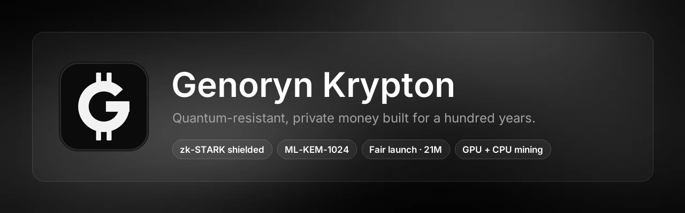
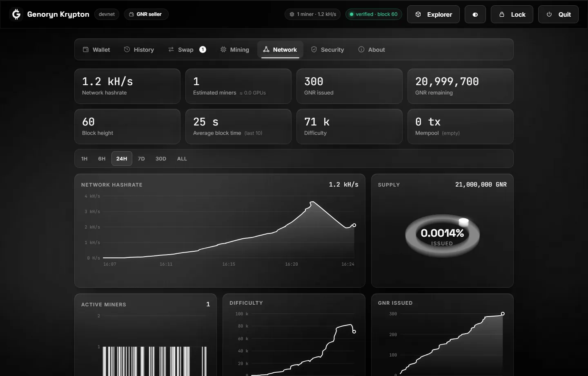
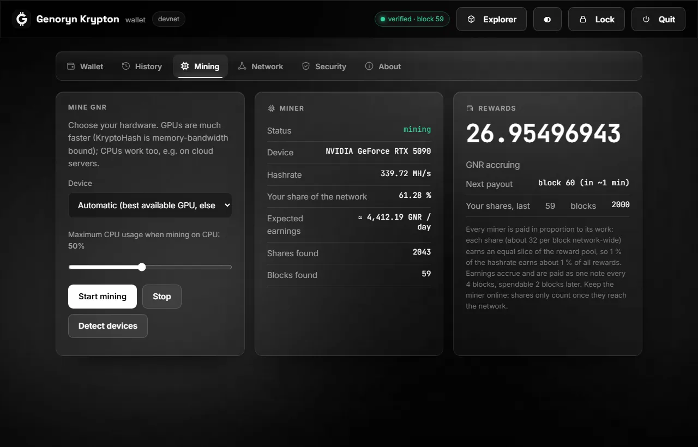
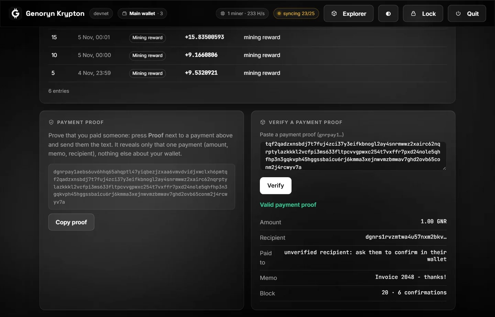

<p align="center">
  <picture>
    <source media="(prefers-color-scheme: light)" srcset="docs/images/banner-light.png">
    
  </picture>
</p>

<p align="center">
  <a href="https://github.com/genoryn/genoryn/releases/latest"></a>
  <a href="https://genoryn.io/explorer.html"></a>
  
  
  
</p>

<p align="center">
  <a href="https://github.com/genoryn/genoryn/releases/latest"><b>Download for Windows</b></a> ·
  <a href="https://github.com/genoryn/genoryn/releases/latest"><b>Linux (.deb / .tar.gz)</b></a> ·
  <a href="https://genoryn.io">genoryn.io</a> ·
  <a href="https://genoryn.io/explorer.html">Explorer</a> ·
  <a href="https://genoryn.io/docs.html">Docs</a> ·
  <a href="SECURITY.md">Security</a>
</p>

<table>
  <tr>
    <td width="33%"></td>
    <td width="33%"></td>
    <td width="33%"></td>
  </tr>
  <tr>
    <td align="center"><sub>Private send &amp; receive</sub></td>
    <td align="center"><sub>Proportional GPU / CPU mining</sub></td>
    <td align="center"><sub>Payment proofs</sub></td>
  </tr>
</table>

---
## Why this exists

Most cryptocurrencies rest on elliptic-curve cryptography. A large enough quantum
computer running Shor's algorithm breaks it: it can forge spending signatures, and it
can decrypt every private transaction ever recorded ("harvest now, decrypt later").
Money meant to hold value for generations cannot depend on that assumption.

Genoryn Krypton is built from first principles so that **no elliptic curve protects your
coins or your privacy**:

| Purpose | Mechanism | Assumption |
|---|---|---|
| Spending authorization | zk-STARK proof of knowledge of a secret key (hash preimage) | Collision-resistant hashes |
| Transaction privacy | Shielded notes, zk-STARK proofs (Winterfell, Rescue-Prime, SHA3-256 Merkle commitments) | Hashes + FRI soundness |
| Note encryption | Hybrid **X25519 + ML-KEM-1024** (NIST FIPS 203, level 5) → XChaCha20-Poly1305 | Either primitive unbroken |
| Peer-to-peer links | Hybrid **X25519 + ML-KEM-768** → ChaCha20-Poly1305 | Either primitive unbroken |
| Release signing | **ML-DSA-87** (FIPS 204) **and** **SLH-DSA-SHAKE-256s** (FIPS 205) | Lattices *and* hashes (both must verify) |
| Identifiers | SHA3-256 with domain separation | Hashes |
| Proof of work | KryptoHash v1 (BLAKE3-based, memory-hard) | Hashes |
| Wallet file | Argon2id (256 MiB) + XChaCha20-Poly1305 | Symmetric primitives (256-bit keys) |

Grover's algorithm only square-roots brute force; 256-bit hashes and keys keep a
128-bit post-quantum margin, and recovery phrases carry **384 bits** of entropy (a
192-bit margin). Every algorithm carries a versioned identifier so the network can
migrate to new primitives by soft fork if one ever weakens.

> **Honest status.** The code is complete and tested end to end, but it has **not** had
> an independent audit yet. The STARK spend circuit, its zero-knowledge masking and the
> consensus code are original work and should be reviewed before significant value is
> trusted to them. Reviews are welcome (see [SECURITY.md](SECURITY.md)).

## At a glance

| | |
|---|---|
| Ticker | **GNR** (1 GNR = 100,000,000 gori) |
| Block time | 60 seconds, LWMA difficulty retarget every block |
| Block reward | **5 GNR**, halving every **2,100,000 blocks** (~4 years) |
| Maximum supply | **21,000,000 GNR** (integer halving leaves < 1 GNR of dust) |
| Premine / dev fee / early bonus | **None.** The genesis block issues nothing |
| Privacy | Every transfer is shielded; no transparent mode |
| Transaction | 2 inputs → 2 outputs, ~97 KB, proof ~92 KB, verified in ~2 ms |
| Proving time | ~0.5 s on a desktop CPU |
| Proof of work | KryptoHash v1, GPU-first, CPU-capable |
| Mining rewards | **Proportional to hashrate**: ~32 shares per block, each paid an equal slice of the reward pool |
| Payouts | One note per miner every 360 blocks (~6 h), spendable after 100 blocks |
| Payment proofs | Prove a payment to anyone without revealing anything else |
| Recovery phrase | 24 words with numbers (`orbit-42 …`), 384-bit entropy, checksummed |
| Addresses | Full post-quantum address with a 128-bit checksum, plus a verified short form |
| Light clients | MMR-committed headers, FlyClient-style sampling, verified compact blocks |

## Fair launch

There is no premine, no allocation and no privileged key. Rewards go only to miners,
under the same rule from block 1, and in proportion to their work: a miner with 1 % of the
hashrate earns about 1 % of the rewards, without joining a pool
([docs/spec/rewards.md](docs/spec/rewards.md)).

**Mainnet is live.** Its genesis commits to the hash of **Bitcoin block 974,438**
(`00000000000000000001075275c9ea6c90ce99dd94214d855d2b726fb173bed9`), the newest Bitcoin
block at launch. That hash could not be known in advance, so no Genoryn Krypton block can
predate it, not even for its author.

| | |
|---|---|
| Genesis hash | `3c10136cd72a74d673257249752522e0102b6268f5b8c348ba34ae36740ca3b3` |
| Genesis time | 2026-11-03 20:43:11 UTC |
| Chain id | `genoryn-krypton-mainnet-1` |

See [docs/launch.md](docs/launch.md) to verify it yourself.

## Mining: your choice of GPU or CPU

KryptoHash reads 64 random 128-byte pairs from a large dataset per hash (2 GiB at
launch, growing 4 MiB per ~11-day epoch up to 12 GiB), so speed follows memory bandwidth.

| Device | Hashrate (measured) |
|---|---|
| NVIDIA RTX 5090 (CUDA) | **74.2 MH/s** |
| Intel Core Ultra 9 285K, 24 threads | **1.37 MH/s** |
| Verification without the dataset | ~1 ms per block |

```sh
krypton-miner --list-devices
krypton-miner --node http://127.0.0.1:30334 --address-file my-address.txt --backend auto   # best GPU, else CPU
krypton-miner --node http://127.0.0.1:30334 --address-file my-address.txt --backend cpu --max-cpu 50
```

The desktop wallet has a **Mining** tab with the same choices and a CPU limit slider.
GPU solutions are always re-verified on the CPU before they are submitted.

### Paid by your share of the work

There are no pools and no lottery for whole blocks. Every hash is also checked against a
**share target** 32 times easier than the block target, so the network finds about 32
shares per block. Each block adds its reward to a consensus-held pool, and every share
earns its miner an equal slice:

| Your share of the network hashrate | Expected GNR per day |
|---|---|
| 88 % | ≈ 6,336 |
| 10 % | ≈ 720 |
| 1 % | ≈ 72 |
| 0.1 % | ≈ 7.2 |

A share's credit never depends on which other shares a block includes, so censoring other
miners gains nothing, and an excluded share is credited by a later block. Earnings are paid
as one note every 360 blocks. The wallet shows your share of the network, expected
earnings and rewards accruing in real time. Keep the miner online: shares count once they
reach the network. Rules: [docs/spec/rewards.md](docs/spec/rewards.md).

## Payment proofs

Every transfer is private, yet you can still prove you paid. In the wallet's **History**
tab, press **Proof** next to a payment (or run `krypton-wallet-cli prove-payment <txid>`)
and give the `gnrpay1…` text to whoever needs it. They paste it into **Verify a payment
proof** (or `verify-payment`) and see the amount, memo, recipient, block and confirmations,
checked against the chain. The proof discloses the one-time key of that single output and
nothing else: not your balance, your other payments or your keys.

## Recovery phrase and addresses

A new wallet shows **24 words, each with a two-digit number** (`orbit-42 river-07 …`):
408 bits that carry 384 bits of entropy and a 24-bit checksum. The checksum catches any
wrong word or number on restore; older 24-word phrases still restore.

The full address (~2,600 characters) carries the post-quantum ML-KEM-1024 + X25519 key and
a 128-bit checksum, so a typo or tampering is always detected. Its short form
(`gnrs1…`) is a content hash: every wallet checks that what a node resolves hashes back to
it, so a node can never substitute another recipient.

## No full node required

A wallet should not need hundreds of gigabytes to show a balance. Genoryn Krypton
light wallets **trust servers for availability only, never for validity**:

1. **Chain:** every header commits to a work-weighted Merkle Mountain Range of all
   previous blocks. The wallet samples headers across the whole history, checks each
   one's proof of work and MMR inclusion against the tip, and fully checks the recent
   window. The cost grows with log(chain length): seconds, even after billions of blocks.
2. **Your blocks:** from the wallet birthday onward, compact blocks arrive with all
   outputs, nullifiers and note-tree updates, and each is checked against its header
   (output digest, nullifier digest, note-tree root).
3. **Witnesses:** to spend, the wallet downloads the whole 4,096-leaf chunk around its
   note and computes the Merkle path itself, so the server learns only the chunk.
4. **Keys** never leave the device; proofs are built locally; transactions can be sent
   through several nodes at once, and several sources are cross-checked.

Users choose in the wallet: **Light** (default) or **Full node** (one click starts
`kryptond` and the wallet switches to it).

## Quick start

```sh
# Build from source (Rust 1.88+)
cargo build --release

# Desktop wallet: its own window (WebView2 on Windows; browser elsewhere)
./target/release/krypton-wallet

# Or the command line
./target/release/krypton-wallet-cli new
./target/release/krypton-wallet-cli --node https://genoryn.io balance
./target/release/krypton-wallet-cli --node https://genoryn.io send <address|short address> 1.5 --memo "thanks"

# Full node (mainnet): P2P 30333, API http://127.0.0.1:30334
./target/release/kryptond
```

Addresses are long (~2,600 characters) because they carry a post-quantum public key;
share the short form (`gnrs1…`) instead, which any node resolves and every wallet verifies.

## Integrating

Every node serves the same API (the public node is `https://genoryn.io`):

* **REST** under `/v1` (info, blocks, transactions, compact blocks, MMR and FlyClient
  proofs, witnesses, address resolution, mining templates)
* **JSON-RPC 2.0** at `/rpc` (`getinfo`, `getblockcount`, `getblock`, `sendrawtransaction`,
  `getblocktemplate`, `submitwork`, ...)
* **WebSocket** at `/v1/ws` (new blocks and transactions)
* **SDKs:** Rust (`krypton-sdk`), C (`libkrypton` + [`krypton.h`](crates/krypton-sdk/include/krypton.h)),
  TypeScript ([`sdk/js`](sdk/js/krypton.ts))

Guides for exchanges, wallets and explorers: [docs/integration](docs/integration).

## Repository layout

| Path | Contents |
|---|---|
| `crates/krypton-crypto` | Post-quantum primitives (ML-KEM, ML-DSA, SLH-DSA, hybrid KEM, Rescue-Prime) |
| `crates/krypton-zk` | The shielded spend AIR and STARK prover/verifier |
| `crates/krypton-pow` | KryptoHash: CPU, CUDA and OpenCL implementations |
| `crates/krypton-core` | Consensus types, rules, emission, difficulty, note tree, MMR, addresses |
| `crates/krypton-store` | Persistent chain state, fork choice, reorganizations |
| `crates/krypton-p2p` | Post-quantum encrypted peer transport |
| `crates/krypton-light` | Light-client protocol and verified HTTP client |
| `crates/krypton-wallet-core` | Wallet engine: keys, sync, shielded transfers |
| `crates/krypton-sdk` | Integration SDK and C ABI |
| `apps/kryptond` | Full node |
| `apps/krypton-miner` | Miner |
| `apps/krypton-wallet` | Desktop wallet (native window, local UI) |
| `apps/krypton-wallet-cli` | Command-line wallet |
| `website` | genoryn.io (static site and explorer) |
| `design` | Shared design tokens and assets |
| `docs` | Specification, integration, launch, design and operations |

## Designed for a hundred years

* **Crypto-agility:** algorithms are versioned; new ones arrive by soft fork with version
  bits, never by surprise.
* **Bounded growth:** fixed-size headers (332 bytes), a 4 MiB block limit, and per-block
  commitments that light clients check without history.
* **Log-time verification:** the header MMR keeps light-client cost logarithmic forever.
* **Hash-based core:** spend authorization and privacy depend only on hash functions,
  the most conservative assumption cryptography has.
* **Note tree for 2^40 outputs:** room for about a trillion payments.
* **No owner:** nothing in the protocol depends on any person or organization existing.

## Author and governance

Genoryn Krypton was created by the pseudonymous author **Zarazi Sokani**, whose identity
is unknown and will never be revealed.

Members of the community are free to develop the project in any direction they
choose, including marketing and other initiatives, following their own strategies. The
protocol itself remains **fully decentralized**: no person, company or foundation
controls it, holds keys over it, or can change its rules. Rules change only when the
people who run nodes choose to run new software. Contributions are judged on their
merits, in public.

## Security

Please report vulnerabilities privately as described in [SECURITY.md](SECURITY.md).
Do not test against other people's funds or nodes.

## License

Dual-licensed under [MIT](LICENSE-MIT) or [Apache-2.0](LICENSE-APACHE), at your option.
Fonts are under the SIL Open Font License (see `design/assets/fonts`).

*Not investment advice. Mining or holding GNR is not a promise of value.*
