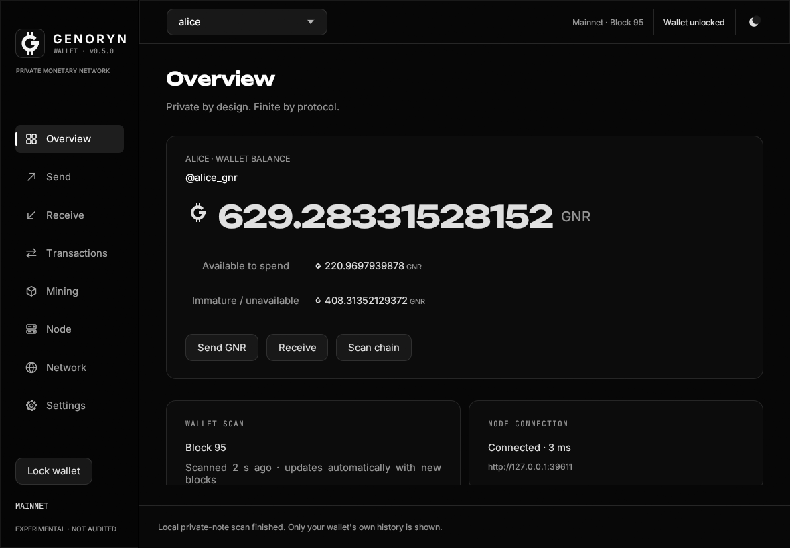
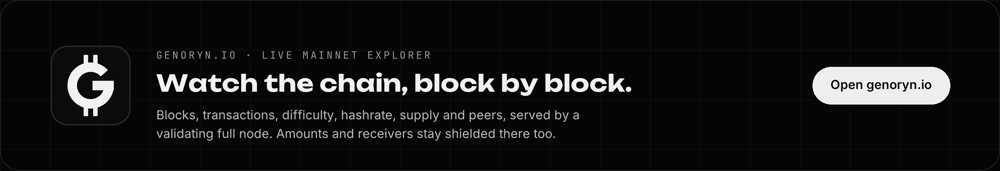
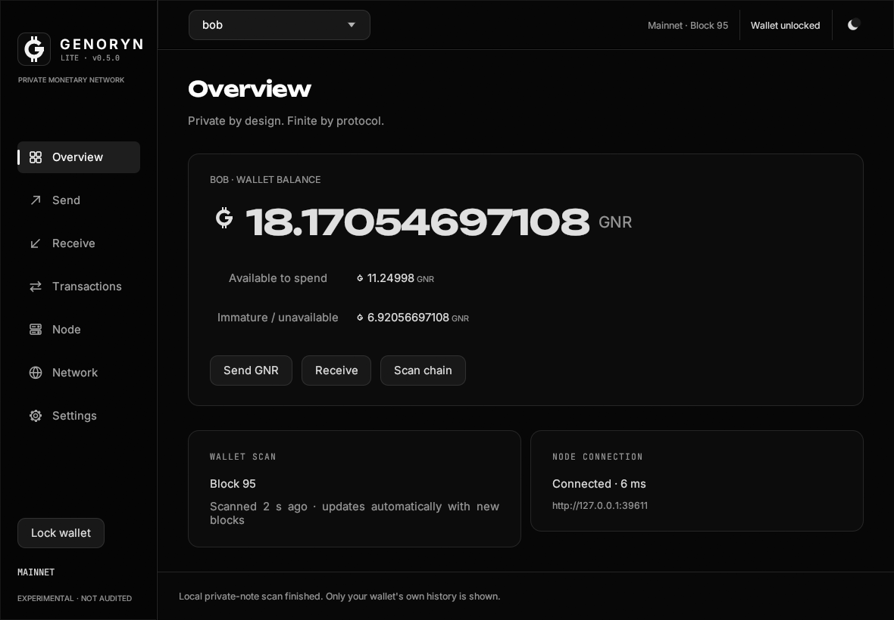
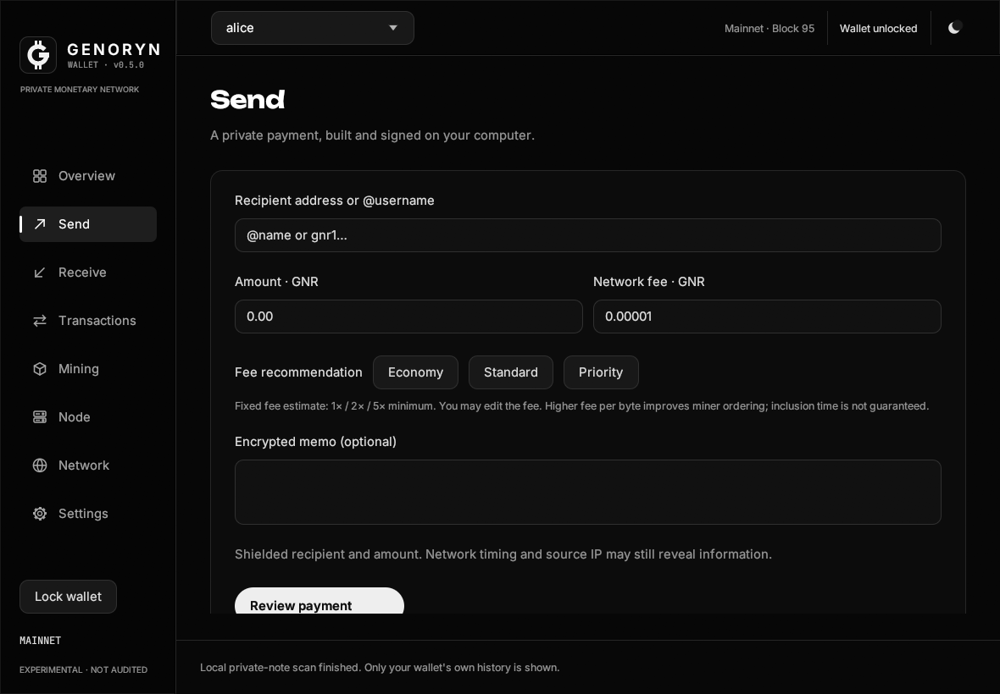
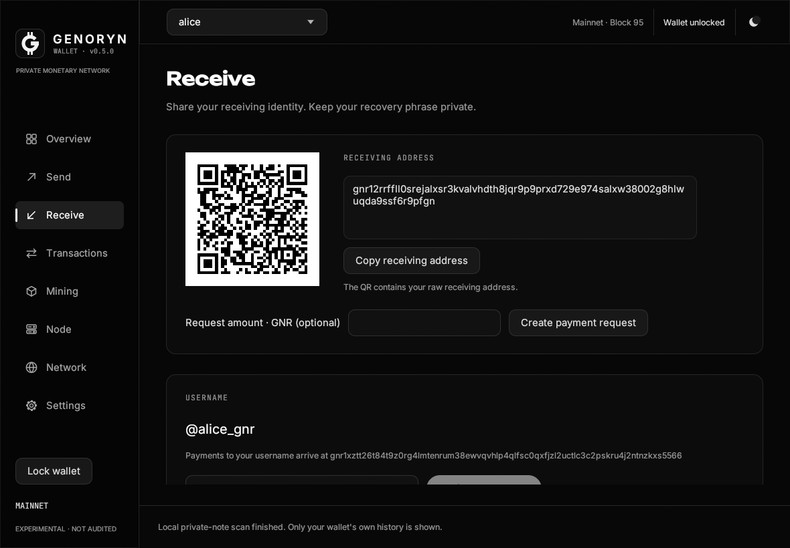
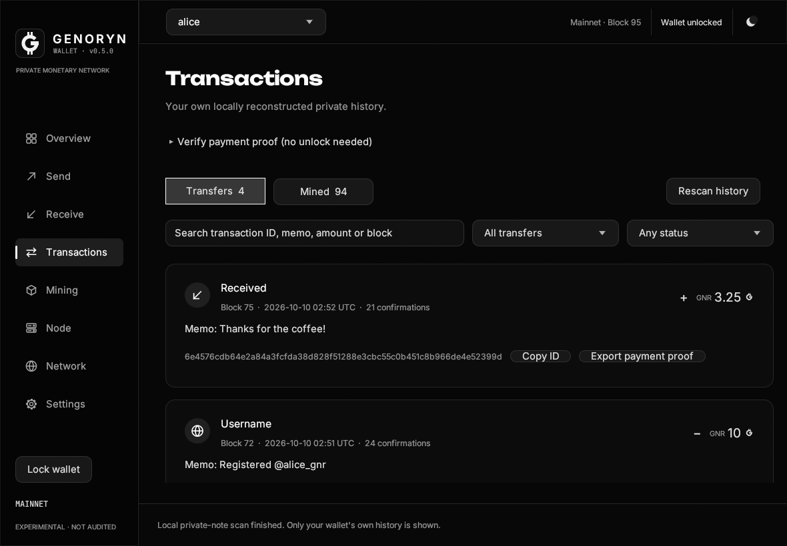
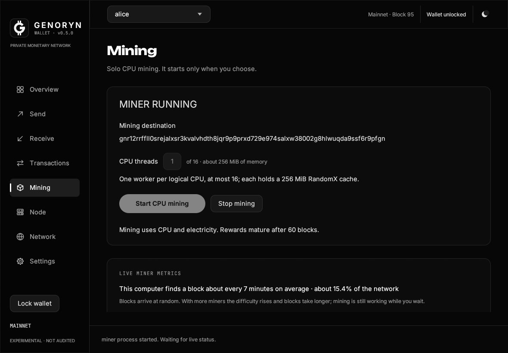
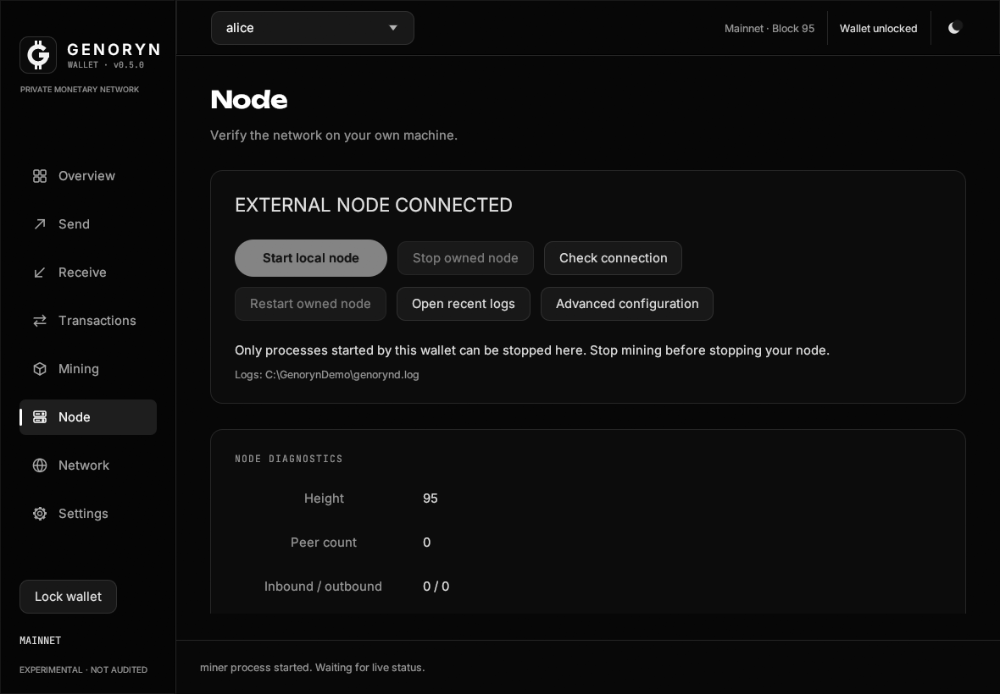
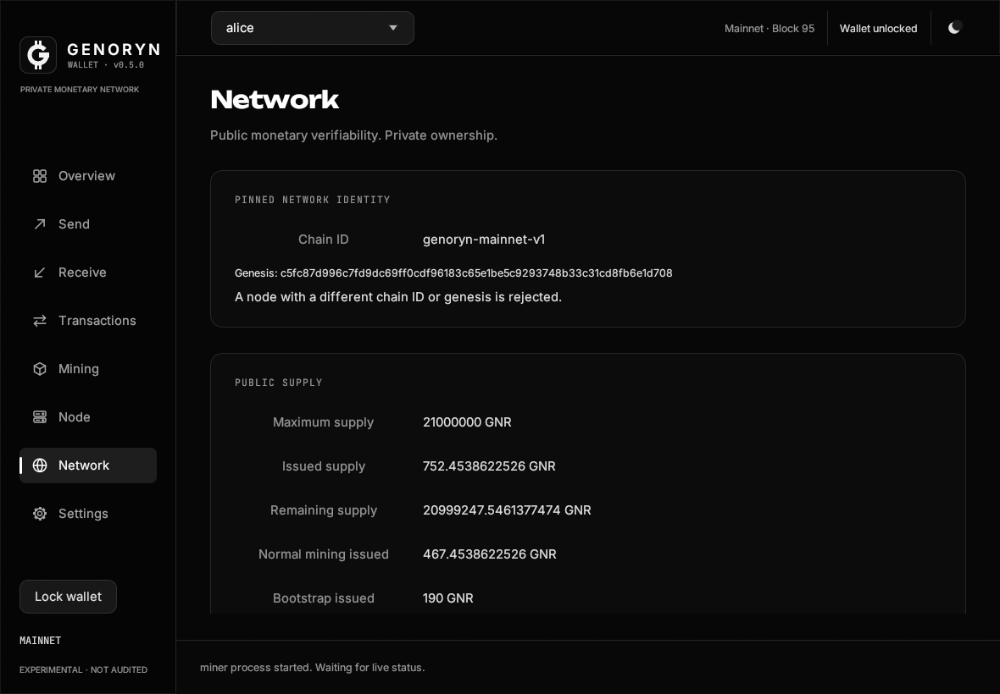
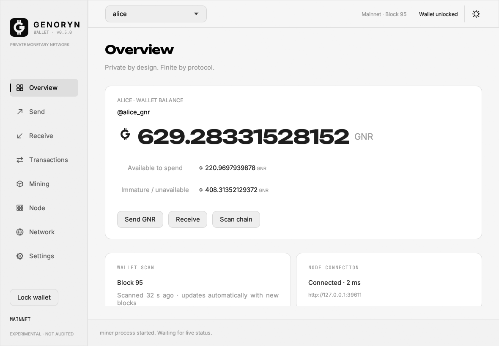

<p align="center">
  <a href="https://genoryn.io/"></a>
</p>

<p align="center">
  <a href="https://github.com/genoryn/genoryn/releases/latest"></a>
  <a href="https://genoryn.io/"></a>
  <a href="docs/network-privacy.md"></a>
  <a href="https://github.com/genoryn/genoryn/actions/workflows/verify.yml"></a>
  <a href="https://github.com/genoryn/genoryn/releases"></a>
  
  <a href="https://github.com/genoryn/genoryn/blob/main/rust-toolchain.toml"></a>
  <a href="#license"></a>
</p>

<h3 align="center">A private, finite, peer-to-peer money you verify yourself.</h3>

<p align="center">
  <b><a href="https://github.com/genoryn/genoryn/releases/latest">Download</a></b> ·
  <b><a href="https://genoryn.io/">genoryn.io</a></b> ·
  <a href="#whats-new-in-060">What's new</a> ·
  <a href="#private-network-built-in-tor">Tor</a> ·
  <a href="#get-started">Get started</a> ·
  <a href="#a-tour-of-the-wallet">Wallet tour</a> ·
  <a href="#why-it-is-safe">Why it is safe</a> ·
  <a href="docs/protocol/consensus.md">Protocol</a> ·
  <a href="docs/security/threat-model.md">Threat model</a>
</p>

GENORYN is an independent proof-of-work monetary network written in Rust. It combines
three ideas that are rarely found together: **privacy by default** through shielded
notes and Halo 2 zero-knowledge proofs, a **hard cap of 21,000,000 GNR** enforced by
integer-only consensus rules, and **CPU-fair RandomX mining** that anyone can run. The
desktop wallet ships with its own full node, so every user validates the chain on
their own machine instead of trusting a server, and with a **built-in Tor client**, so
new installations reach the network without revealing their IP address to peers.

> [!WARNING]
> **The GENORYN mainnet launched on 10 October 2026, and the software has not been
> independently audited.** Mine or hold only what you can afford to lose, and keep your
> recovery words offline. Cryptography protects transaction contents; it does not guarantee
> anonymity against a compromised computer, a tiny anonymity set, timing analysis or
> network surveillance. Read [the threat model](docs/security/threat-model.md) first.

<p align="center">
  
</p>

## What's new in 0.6.0

| | |
|---|---|
| **Tor is built in** | Hybrid and Tor-only modes use a Tor client inside GENORYN. Nothing to download or keep open; Tor Browser or your own Tor still works if you prefer it. |
| **Tor only from the first start** | New installations connect, look up peers and broadcast payments only through Tor. Nothing ever falls back to a direct connection. Existing installations keep their mode until you change it. |
| **Payments always get out** | A payment made while Tor or the network is down waits, survives a restart and goes out as soon as a peer is reachable. A peer that silently drops it can no longer stop it from spreading. |
| **Light wallet** | Run the wallet without a node of its own: it reads the chain from remote nodes over Tor and validates every block on your computer. The remote nodes never see your addresses or balance. |
| **Same chain** | Consensus, the 21,000,000 GNR cap, RandomX, Halo 2 proofs, the peer protocol and wallet files are unchanged. 0.6.0 works with 0.4.x and 0.5.x nodes. |

Full details are in the [0.6.0 release notes](docs/releases/v0.6.0.md).

**0.6.1** makes new Tor-only installations find the network on their own (two mainnet
onion seeds are built in) and accepts usernames typed without `@`. See the
[0.6.1 release notes](docs/releases/v0.6.1.md).

**0.6.2** mines several times faster: all miner threads share one RandomX dataset
instead of a cache each, and the Mining page offers every CPU thread. See the
[0.6.2 release notes](docs/releases/v0.6.2.md).

## genoryn.io: the chain, live

<p align="center">
  <a href="https://genoryn.io/"></a>
</p>

**[genoryn.io](https://genoryn.io/)** is the home of the GENORYN network and its public
explorer, served by a validating mainnet full node. Open it to see:

- **Blocks and transactions** as they arrive, searchable by height, block hash or transaction ID.
- **The network**: block height, difficulty, network hashrate, average block time and connected peers.
- **The money supply**: the miner reward and issued supply against the 21,000,000 GNR cap.
- **The mempool**: transactions waiting for the next block.

What it cannot show is what GENORYN keeps private. Amounts, senders and receivers of
transfers are shielded notes, so no explorer, including this one, can list balances,
trace payments or rank holders. Only your own wallet can find and read your notes.

## A new generation of digital cash

<table>
  <tr>
    <td width="50%" valign="top">
      <h4>Private by design</h4>
      Every transfer is a shielded note. Amounts and receiving identities are hidden
      from chain observers; spends reveal only a nullifier. There is no transparent
      balance database, no address-balance API and no rich list to query.
    </td>
    <td width="50%" valign="top">
      <h4>Finite by protocol</h4>
      Issuance is an exact integer schedule inside 21,000,000 GNR. There is no mint
      transaction class, no founder override and no financial master key. Issuance
      and fees stay public, so anyone can audit the cap.
    </td>
  </tr>
  <tr>
    <td width="50%" valign="top">
      <h4>Fair to mine</h4>
      RandomX proof of work is designed for ordinary CPUs. Mining never starts by
      itself and pays to a receiving address only, so it runs safely while the
      wallet is locked, or on a server that holds no keys.
    </td>
    <td width="50%" valign="top">
      <h4>Verify, don't trust</h4>
      The wallet starts its own full node, which validates every block, proof,
      signature and nullifier. Bootstrap seeds only introduce peers; they are never
      trusted for consensus.
    </td>
  </tr>
</table>

## Download

Both editions are on [the latest release](https://github.com/genoryn/genoryn/releases/latest),
each with a `.sha256` checksum. They share your wallets, so you can switch at any time.

| | **GENORYN** | **GENORYN Lite** |
|---|---|---|
| Windows installer | `GENORYN-Setup-<version>.exe` | `GENORYN-Lite-Setup-<version>.exe` |
| Portable package | `genoryn-<version>-mainnet-windows-amd64.zip` and `-linux-x86_64.zip` | `genoryn-<version>-mainnet-lite-windows-amd64.zip` and `-lite-linux-x86_64.zip` |
| Send, receive, usernames, payment proofs | ✓ | ✓ |
| Own full node that validates everything | ✓ | ✓ |
| CPU mining | ✓ | — |
| For | Everyone who also wants to mine | Paying and getting paid, nothing else |

<p align="center">
  
  <br><sub>GENORYN Lite: the same wallet and node, without the Mining page.</sub>
</p>

The installers need no administrator rights, add Start menu and desktop shortcuts and
uninstall normally; your wallets and chain data in `%USERPROFILE%\.genoryn` are never
touched. [Verify the checksum](docs/security/releases.md) before running.

> [!NOTE]
> GENORYN is not code-signed yet. If Windows 11's **Smart App Control** is on, it blocks
> unsigned programs and the installer explains how to turn it off (Windows Security →
> App & browser control → Smart App Control settings). SmartScreen's "Windows protected
> your PC" is a separate prompt: choose **More info → Run anyway**.

## Get started

1. **Install** GENORYN or GENORYN Lite from the table above.
2. **Open it.** A short launch animation, then the wallet starts its own full node, which
   connects through the built-in Tor and joins the GENORYN mainnet by itself (the first
   Tor start downloads Tor's directory and takes a little longer).
3. **Create a wallet** and write the 24-word recovery phrase on paper. Nothing is
   reachable until the wallet is unlocked with its password, and it locks itself after
   five minutes without input. Your open wallets are remembered, so next time one
   password brings them back.
4. **Get GNR.** Receive from someone, or (in GENORYN) start mining on the Mining page.
   Mined coins mature after 60 blocks, about an hour.
5. **Pay** an address or an `@username`. The wallet checks your matured balance before
   it lets you review a payment.

When a new version is published, the wallet offers its installer; running it updates in
place and keeps your wallets. Nothing is downloaded or installed automatically. See the
[quickstart](docs/quickstart.md) for platform requirements and recovery.

## A tour of the wallet

The wallet is a native Rust application with no embedded website and no remote UI. It
uses the typography of genoryn.io (Inter, Unbounded and JetBrains Mono), only black,
white and gray, and is dark by default with a one-click light mode.

### Overview


Your total balance with the GNR sign, what is available to spend now and what is still
maturing, your `@username`, how far the wallet has scanned and the node connection. With
several wallets open, the top bar shows their combined balance; switch between up to
eight unlocked wallets from it.

### Send



Pay a `gnr1…` address or an `@username`, which your own node resolves and shows before
you confirm. Choose an Economy, Standard or Priority fee and add an encrypted memo only
the receiver can read. **Review payment** stays disabled while your matured balance cannot
cover the amount plus the fee, and says exactly how much is missing.

### Receive and usernames



Your receiving address as text and QR code, payment requests with an amount, and your
on-chain username. Register `@you` once and forever: availability is checked as you type,
the first valid registration wins, and the price is burned (3–4 letters 1,000 GNR,
5–6 letters 100 GNR, 7 or more 10 GNR). A name points to a separate address of your
wallet, so payments to it stay private.

### Transactions



Transfers and mining rewards in separate tabs, with search by transaction ID, memo,
amount or block and filters for direction and confirmations. Every row shows its date,
confirmations and memo, a copyable transaction ID and a **payment proof** export that
discloses that single output to someone you choose.

### Mining (GENORYN)



Solo CPU mining with as many threads as your computer has, paid to the wallet's
receiving address. Live metrics show the hashrate, accepted blocks and how often this
computer finds a block on average at the current difficulty. Mining keeps running while
the wallet is locked. If the miner stops, the page explains why in plain words and
restarts it in portable RandomX mode or with fewer threads when that helps; it never
asks for administrator rights.

### Node and network



The full node the wallet started: height, peers, mempool, difficulty and readable logs,
with start, stop and restart for the node this wallet owns. The Network page sets the
[network privacy mode](docs/network-privacy.md) of the node the wallet starts (Tor only,
Hybrid or Direct), the Tor engine (built in, or your own Tor), the onion service and the
light wallet, and shows Tor progress, readiness, the onion address and the current
connection types; it also shows the pinned chain ID and genesis, which every connection
must match, and the public supply: issued, remaining, mining, bootstrap and the burned
treasury.



### Light mode



The sun/moon button in the top bar switches the appearance at any time; the choice is
remembered.

## Why it is safe

<p align="center">
  
</p>

| Risk | How GENORYN responds |
|---|---|
| Someone copies your wallet file | It is encrypted with Argon2id key derivation and XChaCha20-Poly1305. The recovery phrase comes from operating-system entropy and is never written in plain text. |
| Someone uses your open wallet | Nothing is reachable without the password; the wallet locks after five minutes without input and Lock closes every open wallet. |
| A server learns your balance | There is none to ask. Your wallet finds its own notes by scanning every ciphertext locally. |
| A peer sends invalid blocks | Your node checks proof of work, Halo 2 proofs, signatures, anchors and nullifier uniqueness, with bounded messages and misbehaviour disconnection. |
| Double spends and inflation | Nullifiers are unique across chain and mempool, reorganisations replay state, and coinbase value is fixed by an exact integer schedule. |
| Spending money you do not have | The wallet refuses payments and registrations that its matured balance cannot cover before anything is built or sent, and nodes reject any transaction whose inputs do not exist. |
| Peers learn where you are | New installations reach peers only through the built-in Tor client; your IP address is never sent to a peer, and nothing falls back to a direct connection. |
| A peer drops or delays your payment | Your node keeps it until it is mined or expires, relays it again when it comes back through another peer, and hands it to every new peer. |
| Remote control of your node | Administrative RPC binds to loopback only and requires a private capability token; public RPC is opt-in and only serves chain data and relays transactions. |
| A tampered update | The wallet only points to this repository's releases and never installs anything; every package carries SHA-256 checksums and a manifest with its source commit. |

What privacy does **not** protect against: malware on your computer, copied seeds, weak
passwords, screenshots and clipboard history, transaction timing, a small anonymity set,
or a network observer watching your connection. In Direct mode (earlier installations),
peers see your IP address; Tor modes hide it from peers but not from an adversary who can
watch both ends of a Tor circuit. GENORYN does not claim absolute anonymity, instant finality or
an inherited audit. Details are in the [threat model](docs/security/threat-model.md),
[network privacy](docs/network-privacy.md) and [privacy notes](docs/protocol/privacy.md).

## Private network: built-in Tor

GENORYN has two privacy layers. **Shielded notes** hide amounts, senders and receivers
in every mode. **Tor** hides your computer's IP address from the peers you connect to.
Tor is part of GENORYN: the node carries its own Tor client
([Arti](https://gitlab.torproject.org/tpo/core/arti), from the Tor Project), so there is
nothing to install, configure or keep running.

| Mode | Peers | If Tor stops |
|---|---|---|
| **Tor only** (new wallet installations) | Every connection, peer lookup and payment broadcast through Tor; inbound only through an optional v3 onion service | Networking pauses and payments wait; nothing falls back to direct |
| **Hybrid** | Clearnet peers directly (they see your IP), onion peers and your payments through Tor | Onion peers pause |
| **Direct** (earlier installations, `genorynd` without a mode) | Direct TCP; every peer sees your IP | n/a |

Change the mode on the wallet's **Network** page. From the command line:

```sh
genorynd --network-mode tor-only                    # built-in Tor
genorynd --network-mode tor-only --onion-service    # also accept peers through an onion address
genoryn-cli get-network-privacy                     # Tor progress, onion address, connections
```

A Tor you already run works too: choose **My own Tor** in the wallet, or start the node
with `--tor-socks 127.0.0.1:9050` (Tor Browser: `9150`).

- **Payments**: your node first hands a new payment to a single peer, then spreads it
  more widely, which makes it harder to tell which computer created it. If the network
  is down the payment waits and goes out later, never outside Tor in Tor-only mode.
- **Light wallet**: on the Network page, **Light wallet** runs the wallet without a node
  of its own. It talks to remote nodes only over Tor and validates every block itself.
- **Bootstrap**: Tor-only nodes find mainnet peers through onion seeds published in
  [`seeds/mainnet-onion.txt`](https://github.com/genoryn/genoryn/blob/main/seeds/mainnet-onion.txt),
  read at startup, so seeds can be added without a new release.

Tor does not make anyone fully anonymous: it cannot protect a compromised computer or
defeat an observer who watches both ends of a circuit, and application checks do not
replace operating-system isolation such as Whonix or Tails. Read
[network privacy and Tor](docs/network-privacy.md) before relying on it.

## Mainnet

| | |
|---|---|
| Chain ID | `genoryn-mainnet-v1` |
| Genesis hash | `c5fc87d996c7fd9dc69ff0cdf96183c65e1be5c9293748b33c31cd8fb6e1d708` |
| Launched | 10 October 2026, from block 0, with no premine |
| Explorer | [genoryn.io](https://genoryn.io/) |
| Block target | 60 seconds, difficulty retargeted every block |
| Ports | 29610 peer-to-peer (open it to accept peers in Direct and Hybrid), 29611 loopback-only admin RPC, 29612 public RPC (opt-in; also through the onion service for light wallets), 29613 loopback target for an external Tor's onion service |
| Addresses | `gnr1…` |

A node joins the mainnet by itself. It contacts the built-in seeds and the list
published in [`seeds/mainnet.txt`](https://github.com/genoryn/genoryn/blob/main/seeds/mainnet.txt)
(Tor modes also read [`seeds/mainnet-onion.txt`](https://github.com/genoryn/genoryn/blob/main/seeds/mainnet-onion.txt)),
learns further peers by exchange and validates every block itself. Nodes behind NAT or a
VPN take part through outbound connections; a node bound to loopback stays an isolated
local lab. The devnet and testnet remain for development and automated tests only; their
coins never existed on mainnet. See [peer protocol and discovery](docs/protocol/networking.md).

## Monetary policy

| Allocation | Lifetime maximum | Rule |
|---|---:|---|
| Normal mining | 20,690,000 GNR | Derived integer subsidy, halves every 2,102,400 blocks |
| Bootstrap | 100,000 GNR | 2 GNR per block at heights 1–50,000 |
| Treasury, **burned on mainnet** | 210,000 GNR | 1 GNR per block at heights 1–210,000 |
| **Combined** | **21,000,000 GNR** | No inflation above the cap; rounding dust stays unissued |

**Fair launch.** On mainnet the treasury share is paid to a provably unspendable address:
its key is derived by hashing to the curve, so no spending key exists for anyone,
developers included. There is no premine and no founder allocation, and at most
20,790,000 GNR can ever circulate. The treasury vesting schedule (locked until protocol
year 10) applies only to the devnet and testnet, whose treasury keys are public test
material. See the [monetary ADR](docs/adr/0003-emission.md) and
[exact monetary policy](docs/protocol/monetary-policy.md).

## Architecture

```text
Native wallet / CLI           genoryn-connect
        │ private local scan        │ pinned network + node failover
        └──────────────┬────────────┘
                 Versioned RPC
                       │
       independently validating P2P full nodes
         │ consensus + shielded state │
         │ SQLite WAL + branch replay │
         └──── genuine RandomX PoW ───┘
```

The GUI uses the same wallet and consensus backend as the CLI. Every program defaults to
mainnet; `--network devnet` or `--network testnet` selects a development network.

## Build from source

Prerequisites: Git, Rust 1.92.0, a C/C++ compiler and CMake. Linux also needs X11/Wayland
development libraries; Windows needs Visual Studio Build Tools with the C++ desktop workload.

```sh
git clone https://github.com/genoryn/genoryn.git
cd genoryn
cargo build --release --locked --workspace
./target/release/genoryn-wallet
```

The command-line programs are `genorynd`, `genoryn-miner`, `genoryn-wallet-cli`,
`genoryn-cli` and `genoryn-emission`; the desktop application is `genoryn-wallet`. Append
`.exe` on Windows. Monetary RPC values are decimal strings in **gori**, with
1 GNR = 1,000,000,000,000 gori. Without `genoryn-miner` next to it, the wallet runs as
GENORYN Lite.

<details>
<summary><b>Mining on a server</b></summary>

A miner needs a node and a receiving address, never a wallet file or recovery phrase, so a
server can mine without holding any keys:

```sh
genorynd --data-dir ~/.genoryn/mainnet
genoryn-miner --node http://127.0.0.1:29611 \
  --token-file ~/.genoryn/mainnet/admin.token --wallet YOUR_GNR1_ADDRESS --threads 2
```

The admin token is a private loopback capability, never a spend key, and is never sent to
a remote endpoint. The miner shares one 2 GiB RandomX dataset between all workers
(fast mode, ready about a minute after start; light mode with 256 MiB per worker until
then or with `--randomx-mode light`). If the miner
stops, its last line names the cause, for example
`genoryn-miner stopped [unauthorized]: …` when another node owns the RPC port.

</details>

<details>
<summary><b>Command-line wallet</b></summary>

```sh
genoryn-wallet-cli --wallet ~/.genoryn/mainnet/alice.gnr create
genoryn-wallet-cli --wallet ~/.genoryn/mainnet/alice.gnr address
genoryn-cli get-network-info
genoryn-cli get-supply
```

Create and restore prompts use hidden terminal input. Never paste a seed or password into
command arguments.

</details>

## Status and evidence

The `cc280b5` baseline passed [all four verification jobs](https://github.com/deepdrogo/GENORYN/actions/runs/37739804704)
in the project's earlier repository: Windows and Linux real mining, private payments, seed
and account recovery, reorg/restart, isolated testnet work, 50,000 registered identities,
bounded read RPC, audit, fuzzing and native/packaged launchers, with consensus vectors
matching across both systems ([artifact evidence](docs/testing/evidence/native-artifacts-cc280.json)).
That baseline predates the mainnet releases 0.4.0–0.5.0, which have no recorded
exact-commit CI evidence in this repository. Every later change runs the same
[verification workflow](https://github.com/genoryn/genoryn/actions/workflows/verify.yml)
on its exact commit. The 0.6.0 Tor work also has [recorded local evidence](docs/testing/network-privacy-evidence.md)
on Windows and Linux: live runs over the public Tor network with real mining and proofs
(onion-to-onion peers, payments both ways, a five-minute Tor outage, socket and DNS leak
checks, a light wallet), a mixed 0.4.0/0.5.0/0.6.0 network, fuzzing and the full test suites. See the [requirement map](docs/specification-status.md),
[development journal](DEVELOPMENT_STATUS.md) and [release gate](docs/testing/release-gate.md).
GENORYN has not been independently audited.

## Documentation

- [Quickstart for Windows and Linux](docs/quickstart.md) · [wallet GUI](docs/wallet/gui.md) · [release notes](docs/releases/)
- [Protocol specification](docs/protocol/consensus.md) · [networking](docs/protocol/networking.md) · [network privacy and Tor](docs/network-privacy.md) · [privacy](docs/protocol/privacy.md) · [mining](docs/protocol/mining.md) · [usernames](docs/protocol/usernames.md)
- [RPC reference](docs/rpc/api.md) · [node discovery SDK](crates/genoryn-connect/README.md)
- [Architecture decisions](docs/adr/) · [three-node development lab](docs/testing/devnet.md)
- [Release verification](docs/security/releases.md) · [security policy](SECURITY.md) · [threat model](docs/security/threat-model.md) · [network-privacy review](docs/security/network-privacy-review-2026-10.md) · [dependency review](docs/security/dependency-review.md) · [third-party notices](THIRD_PARTY.md)
- [Brand assets and usage](https://github.com/genoryn/genoryn/tree/main/branding) · [genoryn.io](https://genoryn.io/)

## License

Dual-licensed under [MIT](LICENSE-MIT) or [Apache-2.0](LICENSE-APACHE), at your option. The
bundled fonts are under the SIL Open Font License 1.1. The GENORYN integration has not
inherited an upstream audit; consensus, privacy composition, issuance maturity and network
privacy still need independent review. The mainnet was launched without one: the software
is provided as is, without warranty.
