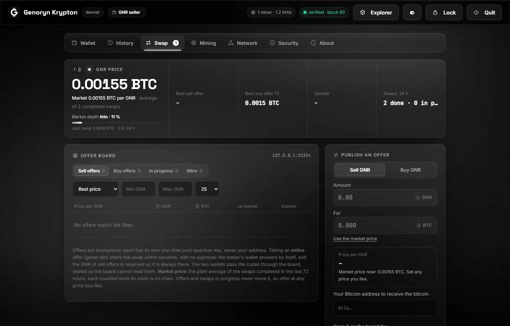

<p align="center">
  <picture>
    <source media="(prefers-color-scheme: light)" srcset="docs/images/banner-light.png">
    
  </picture>
</p>

<p align="center">
  <a href="https://github.com/genoryn/genoryn/releases/latest"></a>
  <a href="https://genoryn.io/explorer"></a>
  
  
  
</p>

<p align="center">
  <a href="https://github.com/genoryn/genoryn/releases/latest"><b>Download for Windows</b></a> ·
  <a href="https://github.com/genoryn/genoryn/releases/latest"><b>Linux (.deb / .tar.gz)</b></a> ·
  <a href="https://genoryn.io">genoryn.io</a> ·
  <a href="https://genoryn.io/explorer">Explorer</a> ·
  <a href="https://genoryn.io/docs">Docs</a> ·
  <a href="SECURITY.md">Security</a>
</p>

<table>
  <tr>
    <td width="50%"></td>
    <td width="50%"></td>
  </tr>
  <tr>
    <td align="center"><sub>Live network and mining overview</sub></td>
    <td align="center"><sub>Atomic BTC ⇄ GNR swaps on the offer board</sub></td>
  </tr>
  <tr>
    <td width="50%"></td>
    <td width="50%"></td>
  </tr>
  <tr>
    <td align="center"><sub>Proportional GPU / CPU mining</sub></td>
    <td align="center"><sub>History</sub></td>
  </tr>
</table>

---
## Why this exists

Most cryptocurrencies rest on elliptic-curve cryptography. A large enough quantum
computer running Shor's algorithm breaks it: it can forge spending signatures, and it
can decrypt every private transaction ever recorded ("harvest now, decrypt later").
Money meant to hold value for generations cannot depend on that assumption.

Genoryn Krypton is built from first principles so that **no elliptic curve protects your
coins or your privacy**, and so that everything a user needs works without trusting
anyone: private payments, fair mining without pools, wallets that verify the chain
themselves, and trading with bitcoin without an exchange.

> **Honest status.** The code is complete and tested end to end, and it has had an internal
> audit and a privately reported external review whose findings are fixed. It has **not**
> had a full independent audit yet. The STARK spend circuit, its zero-knowledge masking and
> the consensus code are original work and should be reviewed before significant value is
> trusted to them. Reviews are welcome (see [SECURITY.md](SECURITY.md)).

## At a glance

| | |
|---|---|
| Ticker | **GNR** (1 GNR = 100,000,000 gori) |
| Block time | 60 seconds, LWMA difficulty retarget every block (90-block window) |
| Block reward | **5 GNR**, halving every **2,100,000 blocks** (~4 years) |
| Maximum supply | **21,000,000 GNR**, enforced by every node |
| Premine / dev fee / early bonus | **None.** The genesis block issues nothing |
| Privacy | Every transfer is shielded; no transparent mode |
| Transaction | 2 inputs → 2 outputs, ~97 KB, proof ~92 KB, verified in ~2 ms |
| Proving time | ~0.5 s on a desktop CPU |
| Proof of work | KryptoHash v1, memory-bandwidth bound, GPU-first, CPU-capable |
| Mining rewards | **Proportional to hashrate**: ~32 shares per block, each paid an equal slice of the reward pool, no pool needed |
| Payouts | One note per miner every 360 blocks (~6 h), spendable after 100 blocks |
| Trading | **Atomic BTC ⇄ GNR swaps** on an anonymous offer board; the seller's GNR is locked first |
| Market price | The plain average of completed swaps; offers never move it |
| Payment proofs | Prove a payment to anyone without revealing anything else |
| Recovery phrase | 24 words with numbers (`orbit-42 …`), 384-bit entropy, checksummed |
| Addresses | Full post-quantum address with a 128-bit checksum, plus a verified short form |
| Light clients | FlyClient-style tip proofs, follow the most work, release checkpoint (block 14,800) |
| Updates | Signed with ML-DSA-87 + SLH-DSA, verified by the wallet before installing |

## Contents

1. [Download and install](#download-and-install)
2. [Quick start](#quick-start)
3. [The desktop wallet, tab by tab](#the-desktop-wallet-tab-by-tab)
4. [Recovery phrase, backup and addresses](#recovery-phrase-backup-and-addresses)
5. [Wallet security](#wallet-security)
6. [Updates](#updates)
7. [Privacy model](#privacy-model)
8. [Cryptography and quantum security](#cryptography-and-quantum-security)
9. [Emission, supply and scarcity](#emission-supply-and-scarcity)
10. [Fair launch](#fair-launch)
11. [Mining](#mining)
12. [Mining and price calculator](#mining-and-price-calculator)
13. [Atomic swaps with bitcoin](#atomic-swaps-with-bitcoin)
14. [The offer board](#the-offer-board)
15. [Market price](#market-price)
16. [Payment proofs](#payment-proofs)
17. [Light clients: no full node required](#light-clients-no-full-node-required)
18. [Peer-to-peer network and node security](#peer-to-peer-network-and-node-security)
19. [Running a node](#running-a-node)
20. [Command-line wallet](#command-line-wallet)
21. [API, SDKs and integration](#api-sdks-and-integration)
22. [Repository layout and specifications](#repository-layout-and-specifications)
23. [Designed for a hundred years](#designed-for-a-hundred-years)
24. [Security and audits](#security-and-audits)
25. [Troubleshooting](#troubleshooting)
26. [FAQ](#faq)
27. [Author and governance](#author-and-governance)
28. [License](#license)

The same material, with more detail, is on [genoryn.io/docs](https://genoryn.io/docs).

## Download and install

| Platform | File | Notes |
|---|---|---|
| **Windows 10 / 11 (x64)** | `GenorynKrypton-<version>-Windows-x64-Setup.exe` | Installs for the current user, no administrator rights, into `%LOCALAPPDATA%\Programs\Genoryn Krypton`. Wallets and chain data live in `%APPDATA%\GenorynKrypton` and are kept when the program is removed. |
| Windows, portable | `genoryn-krypton-<version>-windows-x64-portable.zip` | The same programs without an installer |
| **Ubuntu / Debian (x64)** | `genoryn-krypton_<version>_amd64.deb` | `sudo apt install ./genoryn-krypton_<version>_amd64.deb`; desktop entry and systemd units included |
| Linux, any distribution | `genoryn-krypton-<version>-linux-x64.tar.gz` | Unpack and run `krypton-wallet` |
| From source | this repository | Rust 1.88+: `cargo build --release`; binaries in `target/release` |

All downloads: [releases/latest](https://github.com/genoryn/genoryn/releases/latest). Every
package contains four programs:

| Program | What it is |
|---|---|
| `krypton-wallet` | Desktop wallet in its own window (WebView2 on Windows, the browser elsewhere) |
| `kryptond` | Full node: validates the chain, relays blocks and transactions, serves the API |
| `krypton-miner` | GPU (CUDA, OpenCL) and CPU miner |
| `krypton-wallet-cli` | Command-line wallet |

### Verify your download

Each release publishes `SHA256SUMS` and `SHA256SUMS.sig`, a hybrid post-quantum signature
(ML-DSA-87 **and** SLH-DSA-SHAKE-256s, both must verify) by the release key, fingerprint
`e4567fb116258bdd` ([docs/release-key.pub](docs/release-key.pub)):

```sh
sha256sum -c SHA256SUMS --ignore-missing
cargo run --release -p krypton-release -- verify docs/release-key.pub SHA256SUMS SHA256SUMS.sig
```

The wallet's updater performs exactly this check before it installs anything.

## Quick start

1. **Install** the wallet (above) and open it.
2. **Create a wallet**: choose a strong password and write the 24 words with their numbers on
   paper. Nobody, the project included, can restore a wallet without them.
3. **Get GNR**: mine in the **Mining** tab, buy with bitcoin in the **Swap** tab, or share your
   short address (`gnrs1…`) to receive.
4. **Send privately**: address, amount, optional memo; the proof is built on your computer in
   about half a second.

```sh
# Build from source (Rust 1.88+)
cargo build --release

# Desktop wallet
./target/release/krypton-wallet

# Command-line wallet
./target/release/krypton-wallet-cli new
./target/release/krypton-wallet-cli --node https://genoryn.io balance
./target/release/krypton-wallet-cli --node https://genoryn.io send <address|short address> 1.5 --memo "thanks"

# Full node (mainnet): P2P 30333, API http://127.0.0.1:30334
./target/release/kryptond

# Miner (best GPU, else CPU)
./target/release/krypton-miner --node http://127.0.0.1:30334 --address-file my-address.txt --backend auto
```

## The desktop wallet, tab by tab

The wallet is a small local server bound to `127.0.0.1` with a random session token, shown
in its own window. Keys, scanning and proving never leave your computer.

| Tab | What it does |
|---|---|
| **Wallet** | Balance (spendable, incoming, maturing rewards, optional market value), **Receive** (full address, short form, QR, *Publish short form*), **Send privately** (full or short address, amount, memo, market fee), several wallets with one total, and an overview of the network with live charts and the latest blocks |
| **History** | Paged (15 to 100 per page), filters for received, sent, mining and pending, search by memo, txid, address or block, totals, and a **Proof** button for every send |
| **Swap** | The GNR price, the offer board (sell, buy, in progress, yours), publishing an offer (1 hour to 1 year), taking offers, your swaps with their progress, and a payment window with amount, address and QR code when it is time to pay |
| **Mining** | Automatic, NVIDIA (CUDA), AMD / Intel (OpenCL) or CPU with a CPU cap; hashrate, share of the network, expected GNR per day, shares, accruing rewards, payouts, the miner's error if it stops, and the mining and price calculator |
| **Network** | Charts of hashrate, supply, miners, difficulty, issuance, block time, shares and transactions per block (1 hour to all time), block finders, peers, and the connection mode |
| **Security** | Change a wallet's password, lock wallets |
| **About** | Version, update check, automatic updates |

**Connection mode** (Network tab):

* **Light** (recommended): remote nodes provide data; headers, outputs and tree updates are
  verified on your computer. Several nodes can be configured and are cross-checked.
* **Full node**: one click starts `kryptond`, which downloads and validates the whole chain;
  the wallet then uses only your own node. It connects only out to other nodes unless you
  enable **Let other nodes connect to my full node**.

**Background mining:** while the miner runs, closing the window keeps the wallet, node and
miner running; **Quit** stops everything. If the miner stops, the Mining tab shows why (for
example a GPU driver error); it restarts by itself, and after three quick failures in a row
the wallet stops retrying and says so.

A transaction spends at most two notes. When a payment needs more, the wallet merges notes
automatically in parallel rounds (one block per round) and then pays.

## Recovery phrase, backup and addresses

A new wallet shows **24 words, each with a two-digit number** (`orbit-42 river-07 …`): an
English BIP-39 word and a number 00–63 per token, 17 bits each, 408 bits in total that carry
**384 bits of entropy** and a 24-bit SHA3 checksum. The checksum catches any wrong word or
number on restore; older 24-word phrases still restore.

* **Write it on paper** (or metal), in order, with the numbers. Never type it into a website,
  chat, email or photo: whoever has it owns the coins.
* **Restore**: Wallet → *Add a wallet* → restore, or `krypton-wallet-cli restore`.
* **The wallet file** (`%APPDATA%\GenorynKrypton\mainnet\wallet.krypton`, other wallets in
  `wallets\`) holds your history and swap records. It cannot be opened without its password,
  on any computer: the key comes from the password through Argon2id (256 MiB of memory,
  3 passes) and the file is sealed with XChaCha20-Poly1305, so a changed byte is detected.
  The only attack on a copied file is guessing the password, at a quarter of a gigabyte and
  about a second per guess. The wallet asks for a strong password and shows its strength.
* **Swaps in progress live in the wallet file.** Finish or refund them before relying on a
  restore from the phrase. A restored wallet never reuses an earlier swap's secret, keys or
  outputs (every swap gets a random number).
* **Lost the password, have the phrase?** Restore with a new password. **Lost the phrase,
  have the file and password?** Show the phrase (`krypton-wallet-cli show-phrase`) and write
  it down now.

**Addresses.** The full address (~2,600 characters) carries the post-quantum ML-KEM-1024 +
X25519 key and a 128-bit checksum, so a typo or tampering is always detected. Its short form
(`gnrs1…`) is a content hash: press *Publish short form* once (it goes to genoryn.io, your
configured nodes and your own node), share it, and every sender's wallet checks that what a
node resolves hashes back to it, so a node can never substitute another recipient.

**Several wallets.** Any number, each with its own 24 words and password. The selector switches
between them; *Show all wallets* lists them with search, filters, sorting and one total.
Removing a wallet only moves its file to a `removed` folder; its 24 words bring it back.

## Wallet security

| Protection | How |
|---|---|
| Password for anything that moves coins | Sending, publishing or taking an offer and starting or accepting a swap ask for the wallet's password every time; the session token alone cannot spend |
| Guessing | After 5 wrong passwords the wallet refuses for 5 minutes |
| Auto-lock | An unlocked wallet locks itself after 24 hours; the miner keeps running, swaps wait |
| Local only | The wallet's server listens on `127.0.0.1`, checks a random token on every request and refuses other host names (DNS rebinding) |
| Nothing reaches your computer | The wallet's full node only connects out by default; its API listens only on your computer |
| Signed updates | Installed only if the post-quantum release signature verifies |

Your computer is your responsibility: malware running as your user can read your screen and
keystrokes. Keep the system updated, the phrase offline and the password unique.

## Updates

The wallet checks GitHub for a newer release, downloads `SHA256SUMS`, verifies its hybrid
ML-DSA-87 + SLH-DSA-SHAKE-256s signature against the release key compiled into the program,
downloads the installer and checks it against the signed hash. Only then does it install. A
compromised download host, CDN or GitHub account cannot push code without the release key.
*About → Check for updates*, the offer that appears, or *Install updates automatically*.
Wallets, settings and chain data carry over; a running miner resumes by itself.

## Privacy model

Coins live as **notes**: `(owner, value, randomness)` hidden inside a commitment in a Merkle
tree of depth 40. Spending a note reveals only its **nullifier**, a hash of a secret key and
the note position, which prevents double spending without revealing which note was spent.

| Visible on chain | Hidden |
|---|---|
| Fees, transaction sizes, timing | Sender and recipient |
| Commitments and nullifiers | Amounts and memos |
| Mining shares and payouts per miner | How mined coins are spent later |
| Swap locks and claims (hash lock, revealed secret, refund height) | Swap amounts and the parties' addresses |

Mining income is public per miner, as coinbase rewards are on every chain; mine to a separate
wallet if you want it unlinked from your receiving address. There is no transparent mode, so
every user shares the same anonymity set. Your own transactions are first relayed to one
random peer and announced to everyone only after 20 seconds, which hides their origin. Wallets
download the whole mempool, so nodes cannot tell which pending transaction is whose. Offers on
the board carry one-time keys, never your address, and the board cannot read the messages it
passes.

## Cryptography and quantum security

| Purpose | Mechanism | Assumption |
|---|---|---|
| Spending authorization | zk-STARK proof of knowledge of a secret key (hash preimage) | Collision-resistant hashes |
| Transaction privacy | Shielded notes, zk-STARK proofs (Winterfell, Rescue-Prime, SHA3-256 Merkle commitments) | Hashes + FRI soundness |
| Note encryption | Hybrid **X25519 + ML-KEM-1024** (NIST FIPS 203, level 5) → XChaCha20-Poly1305 | Either primitive unbroken |
| Peer-to-peer links | Hybrid **X25519 + ML-KEM-768** → ChaCha20-Poly1305 | Either primitive unbroken |
| Offer board keys and messages | Hybrid X25519 + ML-KEM-1024 → XChaCha20-Poly1305 | Either primitive unbroken |
| Release signing | **ML-DSA-87** (FIPS 204) **and** **SLH-DSA-SHAKE-256s** (FIPS 205) | Lattices *and* hashes (both must verify) |
| Identifiers | SHA3-256 with domain separation | Hashes |
| Proof of work | KryptoHash v1 (BLAKE3-based, memory-hard) | Hashes |
| Wallet file | Argon2id (256 MiB) + XChaCha20-Poly1305 | Symmetric primitives (256-bit keys) |
| Swap hash locks | SHA-256 (the same lock on both chains) | Hashes |

* **Shor's algorithm** breaks RSA and elliptic curves. None of them protect GNR: spends are
  proofs of knowledge of a hash preimage, verified with hash-based STARKs. Encryption is
  hybrid, so recorded traffic stays secret as long as *either* X25519 or ML-KEM holds.
* **Grover's algorithm** only square-roots brute force: 256-bit hashes and keys keep a 128-bit
  margin, the 384-bit recovery phrase keeps 192 bits, and STARK soundness targets about 160
  conjectured bits.
* **The bitcoin side of a swap** uses Bitcoin's own keys, as every Bitcoin transaction does,
  and only for the few hours a swap runs.
* **Crypto-agility:** every algorithm carries a versioned identifier, so the network can
  migrate to new primitives by soft fork if one ever weakens.

Keys derive from the recovery phrase with SHAKE256: a spend secret (giving an authorization
key `ak`, a nullifier key `nk` and the owner tag `H(ak, nk)`), a hybrid KEM key pair, an ML-DSA
key and a swap seed for one-time board keys and per-swap secrets.

## Emission, supply and scarcity

Block `h ≥ 1` issues `5 GNR >> floor((h − 1) / 2,100,000)` into the reward pool; the genesis
issues nothing. That is 7,200 GNR a day in the first era. Fees join the pool too.

| Era | Blocks | Reward | Per day | Issued in era | Cumulative |
|---|---|---|---|---|---|
| 1 (~years 0–4) | 1 – 2,100,000 | 5 GNR | 7,200 | 10,500,000 | 50.0 % |
| 2 (~4–8) | 2,100,001 – 4,200,000 | 2.5 GNR | 3,600 | 5,250,000 | 75.0 % |
| 3 (~8–12) | 4,200,001 – 6,300,000 | 1.25 GNR | 1,800 | 2,625,000 | 87.5 % |
| 4 (~12–16) | 6,300,001 – 8,400,000 | 0.625 GNR | 900 | 1,312,500 | 93.75 % |
| 5 (~16–20) | 8,400,001 – 10,500,000 | 0.3125 GNR | 450 | 656,250 | 96.88 % |

After 29 halvings the reward reaches zero; integer halving leaves total issuance less than one
GNR below 21,000,000. Every node rejects a block that would exceed the cap.

**Scarcity over time.** Stock-to-flow (coins in existence ÷ coins mined in the next year)
follows from the schedule alone; gold is about 60:

| Year | GNR in existence | New GNR that year | Stock-to-flow |
|---|---|---|---|
| 2030 | 10.5 million | 1.31 million | 8 |
| 2034 | 15.8 million | 657,000 | 24 |
| 2038 | 18.4 million | 329,000 | 56 |
| 2042 | 19.7 million | 164,000 | 120 |
| 2046 | 20.3 million | 82,000 | 248 |

GNR reaches gold's scarcity around 2041 and that of Bitcoin in 2026 around 2045. Scarcity is a
property of the schedule; it does not set a price by itself.

## Fair launch

There is no premine, no allocation and no privileged key. Rewards go only to miners, under the
same rule from block 1, and in proportion to their work.

**Mainnet is live.** Its genesis commits to the hash of **Bitcoin block 974,438**
(`00000000000000000001075275c9ea6c90ce99dd94214d855d2b726fb173bed9`), the newest Bitcoin
block at launch. That hash could not be known in advance, so no Genoryn Krypton block can
predate it, not even for its author.

| | |
|---|---|
| Genesis hash | `3c10136cd72a74d673257249752522e0102b6268f5b8c348ba34ae36740ca3b3` |
| Genesis time | 2026-11-03 20:43:11 UTC |
| Chain id | `genoryn-krypton-mainnet-1` |
| Network magic / ports | `GKM1` · P2P 30333 · API 30334 |

See [docs/launch.md](docs/launch.md) to verify it yourself. Genoryn Krypton is a new chain:
balances of the earlier Genoryn Mainnet 1.0, which used different cryptography, are not
migrated ([policy](https://github.com/genoryn/genoryn/issues/1)).

## Mining

KryptoHash reads 64 random 128-byte pairs from a large dataset per hash (2 GiB at launch,
growing 4 MiB per ~11-day epoch up to 12 GiB), so speed follows memory bandwidth: a desktop
GPU has hundreds of GB/s, a CPU tens. Verifying a block needs only a 16 MiB cache, about 1 ms,
so even light clients check proofs of work. Details: [docs/spec/kryptohash.md](docs/spec/kryptohash.md).

| Device | Hashrate (measured) |
|---|---|
| NVIDIA RTX 5090 (CUDA) | **74–83 MH/s** |
| NVIDIA RTX 4070 SUPER (CUDA, community report) | **~18.5 MH/s** |
| Intel Core Ultra 9 285K, 24 threads | **1.37 MH/s** |
| 16-thread desktop CPU (community report) | ~1.35 MH/s |
| AMD integrated GPU gfx1036 (OpenCL) | ~0.84 MH/s |

```sh
krypton-miner --list-devices          # tests every GPU: "usable" or "NOT usable: <reason>"
krypton-miner --node http://127.0.0.1:30334 --address-file my-address.txt --backend auto   # best GPU, else CPU
krypton-miner --node https://genoryn.io --address-file my-address.txt --backend cuda --devices 0,1
krypton-miner --node http://127.0.0.1:30334 --address-file my-address.txt --backend cpu --max-cpu 50
```

| Flag | Meaning |
|---|---|
| `--backend` | `auto` (best GPU, else CPU), `cuda`, `opencl` or `cpu` |
| `--node` | Node API to get work from (default `http://127.0.0.1:30334`) |
| `--address` / `--address-file` | Where rewards go (the full address) |
| `--max-cpu` / `--threads` | CPU threads as a percentage of the cores, or an exact count |
| `--devices` | GPU indices as in `--list-devices`, e.g. `0,2` |
| `--batch` | Nonces per GPU launch (auto-tuned by default) |
| `--json` | Machine-readable status lines; with `--list-devices`, a JSON list with `usable` and `error` |

The desktop wallet's **Mining** tab offers the same choices and a CPU limit. GPU solutions are
always re-verified on the CPU before they are submitted. If a GPU driver cannot compile the
mining kernel, the miner says so and suggests a clean driver reinstall.

### Paid by your share of the work

There are no pools and no lottery for whole blocks. Every hash is also checked against a
**share target** 32 times easier than the block target, so the network finds about 32 shares
per block. Each block adds its reward and fees to a consensus-held pool, and every share earns
its miner an equal slice: `pool · weight / (8 · 32 · difficulty)`.

| Your share of the network hashrate | Shares per hour | Expected GNR per day |
|---|---|---|
| 88 % | ≈ 1,690 | ≈ 6,336 |
| 10 % | ≈ 192 | ≈ 720 |
| 1 % | ≈ 19 | ≈ 72 |
| 0.1 % | ≈ 2 | ≈ 7.2 |

A share's credit never depends on which other shares a block includes, so censoring other
miners gains nothing, and an excluded share is credited by a later block (any of the next 32).
Earnings are paid as one note every 360 blocks, at most 64 payouts per block, spendable after
100 blocks; payout notes are built by consensus from public data and verified by light wallets.
Keep the miner online: shares count once they reach the network. Rules:
[docs/spec/rewards.md](docs/spec/rewards.md).

## Mining and price calculator

The wallet's Mining tab and [genoryn.io/mining](https://genoryn.io/mining#calc) carry the same
calculator, fed by live chain data:

* **Join now:** from the network's live hashrate, what 1, 10, 100, 1,000 or more GPUs would
  mine: share, GNR per day, month and year, time per GNR, value at the market price.
* **The future:** choose a year (up to 40 ahead) and how many computers mine; the reward follows
  the halvings by block height.
* **Scarcity:** stock-to-flow by year, next to Bitcoin's and gold's.
* **Price models, all "what if", none a forecast:**
  1. *The work behind one GNR:* today's price × how many times more work one GNR takes then
     (more computers sharing the reward, halvings passed).
  2. *A share of Bitcoin's value:* that share divided by the GNR that exist in the chosen year.
  3. *People and dollars:* people × the dollars each holds ÷ the GNR that exist then.

Electricity and hardware are not counted. The real price is only what people pay each other.

## Atomic swaps with bitcoin

GNR is not traded on any exchange, and there was no presale. It is earned by mining, or bought
from another person with bitcoin in the wallet's **Swap** tab, with no exchange and no custody.

Both sides lock their coins under the same **hash lock** (SHA-256 of a secret) with a
**timelock**: whoever reveals the secret to take one side also lets the other side take theirs,
and if nobody does, both refund. Since 1.0.23 **the GNR is locked first**:

1. **Agree.** A buyer takes a sell offer, or a seller takes a buy offer. The wallets exchange
   the swap codes through sealed mailboxes on the board, by themselves, within seconds.
2. **The seller locks the GNR.** The seller's wallet holds the secret and locks exactly the
   agreed GNR on chain, payable only to the buyer with that secret, or back to the seller after
   the GNR timelock.
3. **The buyer checks and pays.** The buyer's wallet waits until the lock has confirmed and is
   exactly the agreed amount, claimable only by the buyer. Only then does it show where to pay
   (amount, address, QR code). The buyer pays within 2 hours into a bitcoin contract with the
   same hash lock.
4. **The seller takes the bitcoin** with the secret, well before the bitcoin timelock. That claim
   reveals the secret on the Bitcoin chain.
5. **The buyer takes the GNR** with the secret read from the seller's bitcoin claim.

A seller who does not have the GNR cannot lock it, so nobody can sell GNR they do not have, and
the seller cannot take the bitcoin without releasing the GNR to the buyer.

| Mainnet timing | Value |
|---|---|
| GNR confirmations the buyer waits for | 6 blocks up to 50 GNR, 15 up to 500 GNR, 30 above |
| Bitcoin confirmations the seller waits for | 1 up to 0.01 BTC, 2 above |
| Payment window | 2 hours after the GNR lock has confirmed |
| GNR timelock | 1,900 blocks (about 32 hours) |
| Bitcoin timelock | 36 Bitcoin blocks (about 6 hours) |
| Longest possible swap | One week; longer terms are refused |

**If something stops:** a buyer who never pays ends the swap and the seller's GNR returns after
its timelock; a seller who never claims lets the buyer's bitcoin return after its timelock; a
side that cancels before anything of its own is locked tells the other side, whose swap ends
too. Keep the wallet running (the window may be closed) and unlocked until your swaps are done:
only your wallet holds the keys that lock, claim and refund your coins, which is also why
nobody else can take them. Specification: [docs/spec/atomic-swaps.md](docs/spec/atomic-swaps.md).

## The offer board

The board, run by nodes under `/v1/swap`, lists offers and passes sealed messages between the
two wallets of a swap; it never sees keys, codes or coins.

| | |
|---|---|
| Durations | 1 hour, 6 hours, 24 hours, 3 days, 1 week, 1 month or 1 year |
| Prices | **Any price may be offered**; the wallet only warns about a likely typo (3× from the market) |
| Amounts | 10,000 sat to 1,000 BTC per offer |
| Proof of work | 18 bits per offer, message and report; offers longer than a day need one bit more per doubling (21 for a week, 23 for a month, 27 for a year: seconds on a modern CPU) |
| Reserved GNR | An open sell offer reserves its amount plus the fee, so a buyer always finds it |
| Online | The maker's wallet pings every 45 s; seen in the last 2 minutes = green dot, takeable, swap starts within seconds without approval |
| Offline | Stays listed, greyed out, not takeable; removed after a week offline (the wallet then frees the GNR) |
| In progress | Only the maker can mark a taken offer "in progress"; its wallet confirms every 10 minutes and removes it as soon as the swap can no longer complete |
| Limits | Up to 5,000 offers, mailboxes of 100 messages kept a day, per-client rate limits |
| Anonymity | Each offer has its own one-time X25519 + ML-KEM-1024 key, never your address |

## Market price

The GNR price shown by the wallet and genoryn.io is the board's market price and nothing else:
**the plain average of the swaps people completed**.

* After a swap completes, the wallets may report its amounts and hash lock (on by default; the
  `share_prices` setting turns it off). The board accepts a report only if a claim with that hash
  lock is on its own chain, and counts each hash once.
* The price is the arithmetic mean of the swaps completed in the last 72 hours, each counting the
  same whatever its size (all recorded swaps while none is that recent).
* With three or more swaps, one more than 4× from their median is left out as a typo or fake.
* **Offers and swaps in progress never move it**; they are listed with their totals in bitcoin
  and dollars. Dollar values use the BTC price, which genoryn.io fetches from mempool.space so
  browsers and wallets contact no third party.

[genoryn.io/market](https://genoryn.io/market) lists every offer and every completed swap with
what the GNR chain proves: the claim transaction, its block, the hash lock, the revealed secret
and the refund height.

## Payment proofs

Every transfer is private, yet you can still prove you paid. In the wallet's **History** tab,
press **Proof** next to a payment (or run `krypton-wallet-cli prove-payment <txid>`) and give the
`gnrpay1…` text to whoever needs it. They verify it in their wallet (or with `verify-payment`, or
`POST /v1/verify-payment`) and see the amount, memo, recipient, block and confirmations, checked
against the chain. The proof discloses the one-time key of that single output and nothing else:
not your balance, your other payments or your keys. It works the moment you send: until the next
block it verifies as **pending**, then as confirmed. A 128-bit checksum rejects altered proofs.

## Light clients: no full node required

A wallet should not need hundreds of gigabytes to show a balance. Light wallets **trust servers
for availability only, never for validity**:

1. **Tip:** every header commits to a work-weighted Merkle Mountain Range of all previous blocks.
   The wallet samples headers across the whole history, checks each one's proof of work and MMR
   inclusion against the tip, and fully checks the recent 91 headers, including the difficulty
   rule. Cost grows with log(chain length).
2. **Checkpoint:** every release carries a checkpoint (mainnet: block 14,800) that the chain must
   contain; headers above it need at least 1/16 of its difficulty, also on average.
3. **No future blocks:** a header dated more than two hours ahead of the computer's clock is
   refused, so a fork cannot lower its own difficulty quickly.
4. **The most work wins:** the MMR proves the chain's total work. The wallet remembers the most
   work it has verified and refuses a lighter chain, so a cheap fork cannot replace the chain it
   follows and faking confirmations costs as much as honest mining. If a node proves the wallet
   followed a fork, the wallet goes back to the fork point by itself.
5. **Your blocks:** compact blocks since the wallet birthday are checked against their headers
   (outputs, nullifiers, payouts, note-tree root).
6. **Witnesses:** to spend, the wallet downloads a whole 4,096-leaf chunk and computes its own
   Merkle path, so the server learns only the chunk.
7. **Cross-checks:** several configured nodes must agree; transactions go out through all of them.

Specification: [docs/spec/light-client.md](docs/spec/light-client.md).

## Peer-to-peer network and node security

A node is built so that other nodes can never use it against the computer it runs on.

| | |
|---|---|
| Encryption | Every link: X25519 + ML-KEM-768 handshake, ChaCha20-Poly1305 frames |
| Memory safety | Networking code in Rust with **no `unsafe` code**; peers can only send protocol messages, never commands or file access |
| Limits | Frames ≤ 8 MiB (checked before allocating), caps on every list, 10 s handshakes, ≤ 64 handshakes at once, 30 s to introduce itself, ≤ 4 connections per IP (IPv6 /64), 64 inbound and 8 outbound peers, bounded send queues |
| Bans | Malformed messages, invalid blocks or transactions, shares without work: disconnect and refuse the IP for 24 hours |
| Address book | Only public internet addresses on unprivileged ports (never this computer, its local network or special ranges), at most 16 per network group (IPv4 /16, IPv6 /32), one list per peer every 10 minutes, seeds first when a node has few peers |
| Wallet's node | **Outbound-only by default**: nothing on the internet can open a connection to your computer unless you allow it |
| API | Listens on `127.0.0.1` by default; no administrative or wallet functions |

Specification: [docs/spec/addresses-and-p2p.md](docs/spec/addresses-and-p2p.md).

## Running a node

```sh
kryptond                                       # mainnet: P2P 0.0.0.0:30333, API 127.0.0.1:30334
kryptond --no-listen                           # connect out only
kryptond --listen 0.0.0.0:30333 --rpc 127.0.0.1:30334 --peer 2.24.162.163:29710
sudo deploy/setup-server.sh mainnet --miner address.txt   # Linux server: systemd, CPU miner capped at 50 %
```

| Flag | Default | Meaning |
|---|---|---|
| `--network` | mainnet | mainnet, testnet or devnet |
| `--data-dir` | `%APPDATA%\GenorynKrypton` or `~/.genoryn-krypton` | Chain database |
| `--listen` | `0.0.0.0:30333` | P2P listen address |
| `--no-listen` | off (on for the wallet's node) | Accept no incoming peers |
| `--rpc` | `127.0.0.1:30334` | API listen address |
| `--peer` | – | Extra peer (host:port), repeatable |
| `--no-seeds` | off | Do not use the built-in seeds |
| `--max-inbound` / `--max-outbound` | 64 / 8 | Peer limits |

| Network | P2P | API | Reward maturity |
|---|---|---|---|
| Mainnet | 30333 | 30334 | 100 blocks |
| Testnet | 31333 | 31334 | 20 blocks |
| Devnet (local) | 32333 | 32334 | 2 blocks |

Storage grows by at most ~4 MiB per block when blocks are full; empty blocks are a few kilobytes.
Expose the API to the internet only behind a reverse proxy with limits (see `deploy/caddy`).

## Command-line wallet

`krypton-wallet-cli [--node URL[,URL…]] [--wallet FILE] [--network NAME] <command>` (or
`KRYPTON_NODE`, `KRYPTON_WALLET`, `KRYPTON_NETWORK`). With several nodes it syncs from the first,
cross-checks the others and sends through all of them.

| Command | What it does |
|---|---|
| `new` | Create a wallet and show its 24-word recovery phrase once |
| `restore [--birthday H]` | Restore from a recovery phrase (asks for the words) |
| `address [--publish]` | Show the receiving address; `--publish` makes its short form resolve on the node |
| `sync` / `balance` | Verified light sync / the balance |
| `send <address> <amount> [--memo …] [--fee …]` | Send GNR to a full or short address |
| `consolidate` | Merge the two largest notes |
| `history` / `notes` | Transactions / owned notes |
| `show-phrase` | Show the recovery phrase (asks for the password) |
| `reset-pending` | Forget unconfirmed spends after they expired |
| `status` | Status of every configured node |
| `prove-payment <txid>` / `verify-payment <proof>` | Create / check a payment proof |

## API, SDKs and integration

Every node serves the same API; the public node is `https://genoryn.io`. Amounts are in gori,
prices in sat per GNR.

| Group | Endpoints |
|---|---|
| Chain | `GET /v1/info` · `/v1/supply` · `/v1/stats?range=…` · `/v1/blocks` · `/v1/block/{height\|hash}` · `/v1/header/{h}` · `/v1/rawblock/{h}` · `/v1/peers` |
| Transactions | `GET /v1/tx/{txid}` · `POST /v1/tx` · `GET /v1/mempool` · `/v1/fee` · `/v1/rawtx/{txid}` · `/v1/nullifier/{hex}` · `POST /v1/verify-payment` |
| Light wallets | `GET /v1/compact` · `/v1/frontier/{h}` · `/v1/subtree/{chunk}` · `/v1/witness/{pos}` · `/v1/mmrproof` · `/v1/flyclient` |
| Addresses | `GET /v1/validate/{address}` · `POST /v1/address` · `GET /v1/address/{short}` · `/v1/address-info/{address}` |
| Mining | `POST /v1/mining/template` · `POST /v1/mining/submit` · `GET /v1/miner/{address}` · `/v1/shares` |
| Swap board | `GET/POST /v1/swap/offers` · `POST /v1/swap/offers/cancel` · `/v1/swap/offers/ping` · `/v1/swap/progress` · `/v1/swap/inbox` · `GET /v1/swap/inbox/{id}` · `POST /v1/swap/trade` · `GET /v1/swap/market` |
| JSON-RPC 2.0 | `POST /rpc`: `getinfo`, `getblockcount`, `getbestblockhash`, `getblockhash`, `getblock`, `getblockheader`, `gettransaction`, `sendrawtransaction`, `getmempoolinfo`, `getpeerinfo`, `getnetworkhashps`, `getsupply`, `validateaddress`, `resolveaddress`, `getblocktemplate`, `submitwork` |
| WebSocket | `wss://genoryn.io/v1/ws`: node info, then `{"type":"block",…}` and `{"type":"tx",…}` events |

```sh
curl -s https://genoryn.io/v1/info
curl -s https://genoryn.io/v1/swap/market
curl -s https://genoryn.io/rpc -d '{"jsonrpc":"2.0","id":1,"method":"getblock","params":[1]}'
```

**SDKs:** Rust (`krypton-sdk`), C (`libkrypton` + [`krypton.h`](crates/krypton-sdk/include/krypton.h)),
TypeScript ([`sdk/js`](sdk/js/krypton.ts)).

```ts
import { KryptonClient, formatAmount } from "@genoryn/krypton";
const k = new KryptonClient("https://genoryn.io");
const info = await k.info();
console.log(info.height, formatAmount(BigInt(info.supply)));
k.subscribe(e => e.type === "block" && console.log("new block", e.height));
```

```rust
use krypton::{NodeClient, Wallet, Address};
let node = NodeClient::new("https://genoryn.io")?;
let mut wallet = Wallet::open("wallet.krypton".as_ref(), &password)?;
wallet.sync(&node, |_, _| {})?;
let to = Address::decode(&recipient)?;
wallet.send_auto(&node, &to, 150_000_000, 200_000, "memo", |s| println!("{s}"))?;
```

**Exchanges and services:** run your own `kryptond`; use a dedicated wallet and tell customers
apart by memo or account; credit after 10 confirmations (more for large amounts); validate
addresses with `/v1/validate` or `krypton_address_network`; give customers payment proofs when a
withdrawal is disputed. Guides: [docs/integration](docs/integration).

## Repository layout and specifications

| Path | Contents |
|---|---|
| `crates/krypton-crypto` | Post-quantum primitives (ML-KEM, ML-DSA, SLH-DSA, hybrid KEM, Rescue-Prime) |
| `crates/krypton-zk` | The shielded spend AIR and STARK prover/verifier |
| `crates/krypton-pow` | KryptoHash: CPU, CUDA and OpenCL implementations |
| `crates/krypton-core` | Consensus types, rules, emission, difficulty, note tree, MMR, addresses |
| `crates/krypton-store` | Persistent chain state, fork choice, reorganizations |
| `crates/krypton-p2p` | Post-quantum encrypted peer transport, limits, address book |
| `crates/krypton-light` | Light-client protocol and verified HTTP client |
| `crates/krypton-wallet-core` | Wallet engine: keys, sync, shielded transfers, swap locks |
| `crates/krypton-swap` | BTC ⇄ GNR atomic swaps: the Bitcoin HTLC, the swap engine, the offer board and the market price |
| `crates/krypton-sdk` | Integration SDK and C ABI |
| `apps/kryptond` | Full node, API, offer board |
| `apps/krypton-miner` | Miner |
| `apps/krypton-wallet` | Desktop wallet (native window, local UI, updater) |
| `apps/krypton-wallet-cli` | Command-line wallet |
| `apps/krypton-setup` / `apps/krypton-release` | Windows installer / release signing and verification |
| `website` | genoryn.io (static site, explorer, market) |
| `design` | Shared design tokens and assets |
| `deploy` | Server setup, systemd units, Caddy configuration |
| `docs` | Specifications, audits, integration, launch and design |

| Specification | Topic |
|---|---|
| [consensus.md](docs/spec/consensus.md) | Blocks, headers, validity rules, difficulty, fork choice |
| [spend-circuit.md](docs/spec/spend-circuit.md) | The zk-STARK spend circuit |
| [rewards.md](docs/spec/rewards.md) | Shares, the reward pool, payouts |
| [kryptohash.md](docs/spec/kryptohash.md) | The proof-of-work algorithm |
| [light-client.md](docs/spec/light-client.md) | Header MMR, FlyClient, work rules, compact blocks |
| [addresses-and-p2p.md](docs/spec/addresses-and-p2p.md) | Addresses, short forms, the peer protocol |
| [atomic-swaps.md](docs/spec/atomic-swaps.md) | Swaps, the offer board, the market price |
| [launch.md](docs/launch.md) · [design.md](docs/design.md) | The launch procedure · design rationale |

## Designed for a hundred years

* **Crypto-agility:** algorithms are versioned; new ones arrive by soft fork with version bits,
  never by surprise.
* **Bounded growth:** fixed-size headers (332 bytes), a 4 MiB block limit, bounded decoders,
  mempool and board, and per-block commitments that light clients check without history.
* **Log-time verification:** the header MMR keeps light-client cost logarithmic forever.
* **Hash-based core:** spend authorization and privacy depend only on hash functions, the most
  conservative assumption cryptography has.
* **Note tree for 2^40 outputs:** room for about a trillion payments.
* **No owner:** nothing in the protocol depends on any person or organization existing.
* **Roadmap:** recursive proof aggregation per block, prebuilt GPU kernels per architecture,
  more independent public nodes, external audits.

## Security and audits

* **November 2026, private report:** an independent researcher reported issues through GitHub
  security advisories (light-client chain selection, swap board authorization, and smaller
  hardening items). All were confirmed and fixed in **1.0.33**, together with a swap-secret reuse
  in restored wallets found while answering an issue, and peer address-book hygiene. Details are
  published once most wallets have updated.
* **5 November 2026, internal audit** ([full report](docs/audit/2026-11-05-security-audit.md),
  [previous review](docs/audit/2026-11-security-review.md)): four reviewers covered the node and
  peer-to-peer layer, consensus and rewards, the wallets and light client, and the website and
  server. No way was found to mint coins beyond the schedule, spend someone else's coins, break
  transfer privacy or forge a block; every fixable finding was fixed in 1.0.7.

| What was checked | Result |
|---|---|
| Emission, reward pool, share crediting, reorg undo | Correct; two reward-timing refinements scheduled for a consensus upgrade |
| zk-STARK spends, post-quantum note encryption, release signatures | No issues |
| Desktop wallet (local API, 24-hour lock, updater, multi-wallet) | Script injection from a hostile node fixed; updater and lock hardened |
| Light-client verification | Checkpoint, difficulty floor, and since 1.0.33 total-work rules: a fake chain costs real mining |
| Public node API and P2P | Per-client limits, bounded downloads, side-branch disk limit, WebSocket caps, public-only address book |
| Swaps and the board | Maker-only board actions, unique swap secrets, end-to-end swaps against Bitcoin Core before releases |
| Explorer and website | Strict CSP, no inline script, API data escaped |
| Dependencies | No known vulnerabilities (`cargo audit`) |
| Server | Key-only SSH, sandboxed services, web traffic only via Cloudflare over HTTPS, no keys stored |

Over a hundred automated tests cover consensus, proofs, reorganizations, forged light-client
data, fake chains, swap flows, board abuse and parser properties. Please report vulnerabilities
privately as described in [SECURITY.md](SECURITY.md) (coordinated disclosure, 90 days). Do not
test against other people's funds or nodes.

## Troubleshooting

<details><summary><b>My GPU is not used, or the miner says "no usable … GPU found"</b></summary>

Run `krypton-miner --list-devices`: it tests every GPU and prints `usable` or
`NOT usable: <reason>`. If the driver could not compile the mining kernel, reinstall the GPU
driver cleanly (on NVIDIA, for example after DDU) and try again. The Mining tab shows the same
reason when the miner stops.
</details>

<details><summary><b>The wallet does not sync, or a node "shows a chain with less proof of work"</b></summary>

A light wallet refuses a node that is behind or shows a lighter chain than one it already
verified. Wait a few minutes, add another node in Network → Connection mode, or start your own
full node. "The node's chain ends before this release's checkpoint" means the node is far behind
or on another network.
</details>

<details><summary><b>My swap seems stuck</b></summary>

Keep the wallet running and unlocked; the swap card says what it waits for. If the buyer never
pays, the seller's GNR returns after about 32 hours; if the seller never claims, the buyer's
bitcoin returns after about 6 hours.
</details>

<details><summary><b>My offer shows as offline</b></summary>

Offers can be taken only while the maker's wallet runs. An offline offer stays listed and is
removed after a week offline, freeing its GNR. Open the wallet to bring it back online.
</details>

<details><summary><b>"Too many wrong passwords"</b></summary>

After five wrong passwords the wallet refuses for five minutes. If you forgot the password,
restore the wallet from its recovery phrase with a new one.
</details>

## FAQ

<details><summary><b>Do I need a GPU or a pool?</b></summary>

Neither. A GPU is about 50 times faster than a CPU, but CPUs mine too, and every block pays all
miners by their shares, so one computer earns its share every block without a pool.
</details>

<details><summary><b>Can anyone see my balance?</b></summary>

No. Balances are computed only by wallets that hold the keys.
</details>

<details><summary><b>How do I buy GNR, and can a swap cheat me?</b></summary>

In the Swap tab: take a sell offer or publish a buy offer. You pay bitcoin only after the
seller's GNR is locked for you on chain, and the seller's claim of your bitcoin reveals the
secret that releases the GNR to you. If anyone stops, timeouts refund both.
</details>

<details><summary><b>Where does the price come from?</b></summary>

Only from completed swaps: their plain average over the last 72 hours. Offers never move it.
</details>

<details><summary><b>Can someone break into my computer through the node?</b></summary>

No. The wallet's node only connects out unless you allow incoming peers, its API listens only on
your computer, the networking code has no unsafe code, and peers can only send checked, limited
protocol messages.
</details>

<details><summary><b>Is there a premine? What about Mainnet 1.0 coins?</b></summary>

There is no premine: the genesis issues nothing and the launch was bound to a then-future Bitcoin
block hash. Krypton is a new chain; balances of the earlier Mainnet 1.0 are not migrated
([policy](https://github.com/genoryn/genoryn/issues/1)).
</details>

<details><summary><b>I lost my recovery phrase</b></summary>

If you still have the wallet file and its password, show the phrase and write it down now.
Without the phrase, the file or the password, nobody can recover the coins.
</details>

## Author and governance

Genoryn Krypton was created by the pseudonymous author **Zarazi Sokani**, whose identity is
unknown and will never be revealed.

Members of the community are free to develop the project in any direction they choose,
including marketing and other initiatives, following their own strategies. The protocol itself
remains **fully decentralized**: no person, company or foundation controls it, holds keys over
it, or can change its rules. Rules change only when the people who run nodes choose to run new
software. The release key signs the project's binaries; it cannot move anyone's coins or change
consensus. Contributions are judged on their merits, in public.

## License

Dual-licensed under [MIT](LICENSE-MIT) or [Apache-2.0](LICENSE-APACHE), at your option.
Fonts are under the SIL Open Font License (see `design/assets/fonts`).

*Not investment advice. Mining or holding GNR is not a promise of value.*
