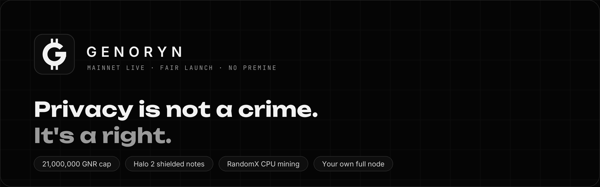
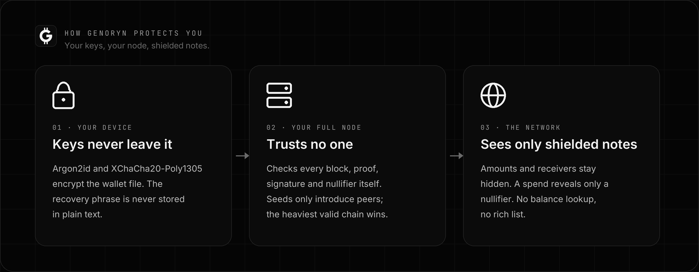

<p align="center">
  <a href="https://genoryn.io/"></a>
</p>

<p align="center">
  <a href="https://github.com/genoryn/genoryn/releases/latest"></a>
  <a href="https://genoryn.io/"></a>
  <a href="docs/network-privacy.md"></a>
  <a href="https://github.com/genoryn/genoryn/releases"></a>
  
  <a href="https://github.com/genoryn/genoryn/blob/main/rust-toolchain.toml"></a>
  <a href="#license"></a>
</p>

<h3 align="center">A private, finite, peer-to-peer money you verify yourself.</h3>

<p align="center">
  <b><a href="https://github.com/genoryn/genoryn/releases/latest">Download</a></b> ·
  <b><a href="https://genoryn.io/">Explorer</a></b> ·
  <a href="#mainnet-10">Mainnet 1.0</a> ·
  <a href="#get-started">Get started</a> ·
  <a href="#quick-mode-and-full-mode">Wallet modes</a> ·
  <a href="#private-network-built-in-tor">Tor</a> ·
  <a href="#run-an-independent-full-node">Run a node</a> ·
  <a href="docs/protocol/emission.md">Monetary Policy &amp; Emission Schedule</a> ·
  <a href="docs/security/threat-model.md">Threat model</a>
</p>

GENORYN is an independent proof-of-work monetary network written in Rust. It combines
three ideas that are rarely found together: **privacy by default** through shielded
notes and Halo 2 zero-knowledge proofs, a **hard cap of 21,000,000 GNR** enforced by
integer-only consensus rules, and **CPU-fair RandomX mining** that anyone can run. One
desktop wallet works either with its own full node or, in **Quick mode**, with remote
nodes over Tor while still validating every block itself, and it carries a **built-in
Tor client**, so new installations reach the network without revealing their IP address.

> [!WARNING]
> **GENORYN has not been independently audited.** Mine or hold only what you can afford
> to lose, and keep your recovery words offline. Cryptography protects transaction
> contents; it does not guarantee anonymity against a compromised computer, a tiny
> anonymity set, timing analysis or network surveillance. Read
> [the threat model](docs/security/threat-model.md) first.

## Mainnet 1.0

GENORYN 1.0.0 launches a **new mainnet** with a new genesis block and chain identity. The
earlier network (`genoryn-mainnet-v1`, releases 0.4–0.6) is retired: its blocks and
transactions are rejected by 1.0, its coins do not exist on 1.0, and reusing a recovery
phrase does not carry any balance over.

| | |
|---|---|
| Chain ID | `genoryn-mainnet-1.0` |
| Genesis hash | `2b27dda9c2adcf9d61a58efc43a40213adc7fb2addfdae210f3357d72adf6b2e` |
| Genesis preimage | `genoryn-mainnet-1.0\|Privacy is not a feature. Privacy is the default.\|GNR\|21000000\|1000000000000\|RandomX-v1\|Ironwood-v3\|early:500x1000\|2026-10-10-mainnet-1.0` |
| Network magic | `0x474e5213` |
| Proof of work | RandomX, 60-second target, LWMA retarget every block, initial difficulty 150,000 |
| Privacy | Orchard / Halo 2 shielded notes (no trusted setup) |
| Maximum supply | 21,000,000 GNR (1 GNR = 10^12 gori) |
| Early mining | Blocks 1–500 pay **1,000 GNR** each: see [Monetary Policy & Emission Schedule](docs/protocol/emission.md) |
| Coinbase maturity | 60 blocks |
| Ports | 29710 peer-to-peer, 29711 loopback-only admin RPC, 29712 public RPC (opt-in), 29713 loopback target for an external Tor's onion service |
| Data directory | `~/.genoryn/mainnet-1.0` (Windows: `%USERPROFILE%\.genoryn\mainnet-1.0`) |
| Addresses | `gnr1…` |
| Explorer | [genoryn.io](https://genoryn.io/) |

### What is new in 1.0

| | |
|---|---|
| **Quick mode and Full mode** | One wallet, two ways to follow the chain. Quick mode needs no node of its own: it downloads blocks from remote nodes over Tor, validates every block on your computer and keeps them, so later syncs fetch only new blocks. Full mode uses your own node. Switching never loses keys, scan progress, pending payments or mining history. |
| **Correct fork choice in Quick mode** | The wallet follows the valid chain with the most cumulative work, computed locally from validated headers, exactly like a full node. A longer chain with less work, a stale source or a source serving invalid blocks is never followed. |
| **Durable outgoing payments** | A payment is signed locally, its exact bytes are stored encrypted on disk, and only then sent. If Tor, the network, a node or your computer fails, the same signed bytes are sent again later; a lost answer never creates a second spend, and its coins stay reserved until the chain settles the outcome. |
| **Complete mining history** | Rewards show as Just mined, Maturing, Mature or Replaced. A reward whose block a heavier chain replaced stays in the history, never in a balance. |
| **Honest balance states** | Unknown balances are never shown as 0, and a balance from unreachable sources is labelled "last verified at block H", never as current. |
| **Reliable Tor switching** | Changing between Tor only, Hybrid and Direct restarts the node the wallet owns through one serialized transition with progress, Cancel and Retry; nothing ever falls back to a direct connection. |
| **GENORYN Explorer link** | The wallet's sidebar opens [genoryn.io](https://genoryn.io/) on request, with a warning in Tor-only mode that your browser does not use GENORYN's Tor. |

Full details: [1.0.0 release notes](docs/releases/v1.0.0.md).

## Monetary policy

| Height | Miner subsidy per block | Notes |
|---|---|---|
| 0 (genesis) | 0 | No premine, no allocation |
| 1 – 500 | **1,000 GNR** | The entire subsidy; 500,000 GNR in total (≈ 2.38 % of the cap) |
| 501 – 2,102,900 | 4.825437595129 GNR | Plus 1 GNR treasury per block for 210,000 blocks, **burned on mainnet** |
| then | halves every 2,102,400 blocks | Reaches zero after 43 halvings; no tail emission |

Fees always go to the miner. Lifetime issuance is 20,999,999.999950064 GNR; integer rounding
leaves 0.000049936 GNR that is never minted, and every block is rejected if issuance would
exceed 21,000,000 GNR. There is **no founder-only minting privilege**: the early reward goes to
whoever mines a valid block. At launch the only known miner is run by the project operator,
so early holdings may be concentrated. The exact schedule, the reasoning and the risks are in
**[GENORYN Monetary Policy & Early Mining Incentives](docs/protocol/emission.md)**.

## Download

Both editions are on [the latest release](https://github.com/genoryn/genoryn/releases/latest),
each with a `.sha256` checksum. They share your wallets, so you can switch at any time.

| | **GENORYN** | **GENORYN Lite** |
|---|---|---|
| Windows installer | `GENORYN-Setup-1.0.0.exe` | `GENORYN-Lite-Setup-1.0.0.exe` |
| Windows portable | `genoryn-1.0.0-mainnet-windows-amd64.zip` | `genoryn-1.0.0-mainnet-lite-windows-amd64.zip` |
| Linux (desktop wallet, full node, miner, CLI tools) | `genoryn-1.0.0-mainnet-linux-x86_64.zip` | `genoryn-1.0.0-mainnet-lite-linux-x86_64.zip` |
| Send, receive, usernames, payment proofs | ✓ | ✓ |
| Quick mode and Full mode | ✓ | ✓ |
| CPU mining | ✓ | — |

Every package contains `release-manifest.json` (version, source commit, toolchain and the
SHA-256 of every file) and `SHA256SUMS`. [Verify the checksum](docs/security/releases.md)
before running:

```sh
sha256sum -c genoryn-1.0.0-mainnet-linux-x86_64.zip.sha256          # Linux
Get-FileHash .\GENORYN-Setup-1.0.0.exe -Algorithm SHA256             # Windows PowerShell
```

> [!NOTE]
> GENORYN is not code-signed. If Windows 11's **Smart App Control** is on, it blocks
> unsigned programs (Windows Security → App & browser control → Smart App Control
> settings). SmartScreen's "Windows protected your PC" is a separate prompt: choose
> **More info → Run anyway**.

## Get started

**Windows:** run `GENORYN-Setup-1.0.0.exe` (no administrator rights needed), or unzip the
portable package and run `Start-Wallet.cmd`.

**Linux:**

```sh
unzip genoryn-1.0.0-mainnet-linux-x86_64.zip
cd genoryn-1.0.0-mainnet-linux-x86_64 && sha256sum -c SHA256SUMS --quiet
./start-wallet
```

Then:

1. **Choose a wallet mode** on the Network page: **Full mode** (default; the wallet starts
   its own node) or **Quick mode** (no node; remote nodes over Tor).
2. **Create a wallet** and write the 24-word recovery phrase on paper. Nothing is reachable
   until the wallet is unlocked, and it locks itself after five minutes without input.
3. **Get GNR.** Receive from someone, or (in GENORYN) start mining on the Mining page.
   Mining never starts by itself. Mined coins mature after 60 blocks, about an hour.
4. **Pay** an address or an `@username`. The wallet checks your matured balance before it
   lets you review a payment, then stores the signed payment before sending it.

See the [quickstart](docs/quickstart.md) for requirements and recovery.

## Quick mode and Full mode

| | **Quick mode** | **Full mode** |
|---|---|---|
| Node on this computer | None | The wallet's own `genorynd` |
| Where blocks come from | Remote nodes' public RPC, only over Tor | Your node's peers |
| Validation | Every block on this computer (RandomX, Halo 2 proofs, state roots) | Your node validates every block |
| Keys, signing, balance | Local | Local |
| What remote nodes learn | When you sync; never your addresses or balance | — |
| What they can do | Withhold new blocks (shown as "last verified at block H") | — |

Quick mode starts with two onion sources (seed 1 and genoryn.io, one operator); add
independent nodes on the Network page for better assurance. Payments in both modes go
through the same durable outbox, and the scan cache, outbox, verified chain and mining
history are encrypted with keys derived from your wallet.

## Private network: built-in Tor

GENORYN has two privacy layers. **Shielded notes** hide amounts, senders and receivers in
every mode. **Tor** hides your computer's IP address from the peers you connect to. The
node and the wallet carry their own Tor client
([Arti](https://gitlab.torproject.org/tpo/core/arti), from the Tor Project).

| Mode | Peers | If Tor stops |
|---|---|---|
| **Tor only** (new installations) | Every connection, peer lookup and payment broadcast through Tor; inbound only through an optional v3 onion service | Networking pauses and payments wait; nothing falls back to direct |
| **Hybrid** | Clearnet peers directly (they see your IP), onion peers and your payments through Tor | Onion peers pause |
| **Direct** | Direct TCP; every peer sees your IP | n/a |

```sh
genorynd --network-mode tor-only                    # built-in Tor
genorynd --network-mode tor-only --onion-service    # also accept peers through an onion address
genoryn-cli get-network-privacy                     # Tor progress, onion address, connections
```

Tor-only nodes find the network through the onion seeds built into the release and the list
in [`seeds/mainnet-1.0-onion.txt`](https://github.com/genoryn/genoryn/blob/main/seeds/mainnet-1.0-onion.txt). Tor does not make anyone
fully anonymous; read [network privacy and Tor](docs/network-privacy.md) before relying on it.

## Network and seeds

A new node finds the network by itself. It contacts the built-in seeds, the lists published
in [`seeds/mainnet-1.0.txt`](https://github.com/genoryn/genoryn/blob/main/seeds/mainnet-1.0.txt) and
[`seeds/mainnet-1.0-onion.txt`](https://github.com/genoryn/genoryn/blob/main/seeds/mainnet-1.0-onion.txt), then learns further peers by
exchange and validates every block itself.

| Seed | Clearnet | Onion (P2P 29710, public RPC 29712) |
|---|---|---|
| Seed 1 (also the launch miner) | `187.7.72.137` | `ycnowntcndxfvr3rkeqkiyfkfvxoqmee3qsrfsz43hq5rkxkmsklrcad.onion` |
| genoryn.io (non-mining) | `2.24.162.163` | `2a6gncfqgp56dgd73vbbicav4552lepqzk6rakltyuuz7hqmttq2diad.onion` |

**Both seeds are run by the same operator.** A network with two seeds of one operator is not
decentralized; it becomes so only as independent people run nodes and miners. Seeds only
introduce peers and are never trusted for consensus.

## Run an independent full node

A full node needs about 1 GB of RAM (plus 2.5 GB if it also mines in fast mode), a few GB of
disk and an outbound internet connection. Opening TCP port 29710 lets others connect to you.

```sh
# Linux, from the release package
unzip genoryn-1.0.0-mainnet-linux-x86_64.zip && cd genoryn-1.0.0-mainnet-linux-x86_64
./genorynd --data-dir ~/.genoryn/mainnet-1.0                  # Direct mode, joins the mainnet
./genorynd --data-dir ~/.genoryn/mainnet-1.0 --network-mode hybrid --onion-service
./genoryn-cli get-network-info
```

Offer a source for Quick-mode wallets with `--public-rpc --onion-service`: the public RPC
(read-only chain data and transaction relay, rate limited) is then also reachable at your
onion address on port 29712. A systemd unit is as simple as:

```ini
[Service]
User=genoryn
ExecStart=/opt/genoryn/genorynd --data-dir /var/lib/genoryn/mainnet-1.0 --network-mode hybrid --onion-service --public-rpc
Restart=always
NoNewPrivileges=true
ProtectSystem=strict
ReadWritePaths=/var/lib/genoryn/mainnet-1.0
```

### Mining on a server

A miner needs a node and a public receiving address, never a wallet file or recovery phrase,
so a server can mine without holding any spending keys:

```sh
genorynd --data-dir ~/.genoryn/mainnet-1.0
genoryn-miner --node http://127.0.0.1:29711 \
  --token-file ~/.genoryn/mainnet-1.0/admin.token --wallet YOUR_GNR1_ADDRESS --threads 4
```

The miner shares one 2 GiB RandomX dataset between all threads (fast mode, ready about a
minute after start; light mode until then). On Linux, reserving 2 MiB pages
(`sysctl vm.nr_hugepages=1280`) and setting `GENORYN_RANDOMX_LARGE_PAGES=1` makes it about
15 % faster. CPU detection selects hardware AES and the JIT automatically; set
`GENORYN_RANDOMX_PORTABLE=1` only for a CPU that cannot run them.

## Explorer and API

[genoryn.io](https://genoryn.io/) shows blocks, transactions, difficulty, estimated hashrate,
average block time, the reward and the issued and remaining supply, searchable by height,
block hash or transaction ID. It never shows balances: shielded notes cannot be read by any
explorer. When its node does not answer, it says when the data was last updated instead of
showing a live zero.

Every node speaks versioned HTTP RPC: `GET /v1/info`, `/v1/genesis`, `/v1/supply`,
`/v1/blocks?from=N`, `/v1/mempool/nullifiers` and `POST /v1/relay` on the public listener;
mining, peer and network administration only on the loopback admin listener with a bearer
token. Monetary values are decimal strings in gori. See the [RPC reference](docs/rpc/api.md).

## Why it is safe

<p align="center">
  
</p>

| Risk | How GENORYN responds |
|---|---|
| Someone copies your wallet file | It is encrypted with Argon2id and XChaCha20-Poly1305; the recovery phrase comes from operating-system entropy and is never written in plain text. |
| A server learns your balance | There is none to ask. The wallet finds its own notes by scanning every ciphertext locally, in both modes. |
| A remote node lies in Quick mode | Every block is validated locally; the chain with the most locally computed work wins; a withheld chain is labelled as possibly out of date. |
| A payment's answer is lost | The exact signed bytes are stored first and sent again; the coins stay reserved until the chain shows the result. |
| Double spends and inflation | Nullifiers are unique across chain and mempool, reorganisations replay state, and issuance follows an exact integer schedule under a hard cap. |
| Replaying old-network transactions | Signatures commit to the 1.0 genesis; transactions of the retired network fail verification. |
| Peers learn where you are | New installations reach peers only through Tor, and nothing falls back to a direct connection. |
| Remote control of your node | Admin RPC binds to loopback and needs a capability token; public RPC is opt-in, read-only plus relay, size-, concurrency- and rate-limited. |
| A tampered download | Every package carries SHA-256 checksums and a manifest with its source commit. |

What privacy does **not** protect against: malware on your computer, copied seeds, weak
passwords, screenshots and clipboard history, transaction timing, a small anonymity set, or
an adversary watching both ends of a Tor circuit. GENORYN does not claim absolute anonymity,
instant finality or an inherited audit.

## Architecture

```text
Desktop wallet / CLI  ── keys, signing, scan, outbox: always local
   │ Full mode                     │ Quick mode
   ▼                               ▼
own genorynd ◄── P2P ──► genorynd seeds ◄── public RPC over Tor (onion)
   │ consensus + shielded state   │ every block also validated by the wallet
   │ SQLite WAL + branch replay   │
   └────── RandomX proof of work ─┘
```

Crates: `genoryn-core` (consensus, emission, RandomX, Orchard/Halo 2), `genoryn-wallet-core`
(keys, scanning, encrypted local storage, outbox), `genoryn` (node, miner, CLI tools,
networking, Tor), `genoryn-wallet` (desktop wallet), `genoryn-connect` (node discovery SDK).

## Build from source

Prerequisites: Git, Rust 1.92.0, a C/C++ compiler and CMake. Linux also needs X11/Wayland
development libraries; Windows needs Visual Studio Build Tools with the C++ workload.

```sh
git clone https://github.com/genoryn/genoryn.git
cd genoryn
cargo build --release --locked --workspace
./target/release/genoryn-wallet
```

Programs: `genorynd`, `genoryn-miner`, `genoryn-wallet-cli`, `genoryn-cli`,
`genoryn-emission` and the desktop application `genoryn-wallet`. Tests:

```sh
cargo test --locked --workspace                        # unit, property and integration tests
cargo test --locked -p genoryn-core -- --ignored       # real proofs, RandomX and mined fixtures
python scripts/test/devnet.py --bin-dir target/debug   # three real nodes: mining, payments, Quick mode, reorg
python scripts/test/all.py                             # the complete practical suite
```

## Known limitations

- **Not independently audited.** Consensus, privacy composition and network privacy still
  need external review.
- **Small network at launch.** Two seeds and one known miner, all run by one operator.
  Wait for more confirmations than you would on a large network.
- **Quick mode downloads full blocks** (no compact filters yet) and trusts remote nodes not
  to withhold data; it detects but cannot prevent withholding.
- **Usernames, names and payment proofs need Full mode.**
- **No code signing** for Windows packages, and no reproducible-build attestation yet.
- **No macOS build.**

## Documentation

- [Monetary Policy & Emission Schedule](docs/protocol/emission.md) · [release notes](docs/releases/v1.0.0.md) · [quickstart](docs/quickstart.md) · [wallet GUI](docs/wallet/gui.md)
- [Consensus](docs/protocol/consensus.md) · [networking](docs/protocol/networking.md) · [network privacy and Tor](docs/network-privacy.md) · [privacy](docs/protocol/privacy.md) · [mining](docs/protocol/mining.md) · [usernames](docs/protocol/usernames.md)
- [RPC reference](docs/rpc/api.md) · [node discovery SDK](crates/genoryn-connect/README.md) · [architecture decisions](docs/adr/) · [development lab](docs/testing/devnet.md)
- [Release verification](docs/security/releases.md) · [security policy](SECURITY.md) · [threat model](docs/security/threat-model.md) · [third-party notices](THIRD_PARTY.md)

## License

Dual-licensed under [MIT](LICENSE-MIT) or [Apache-2.0](LICENSE-APACHE), at your option. The
bundled fonts are under the SIL Open Font License 1.1. GENORYN has not inherited an upstream
audit; the software is provided as is, without warranty.
