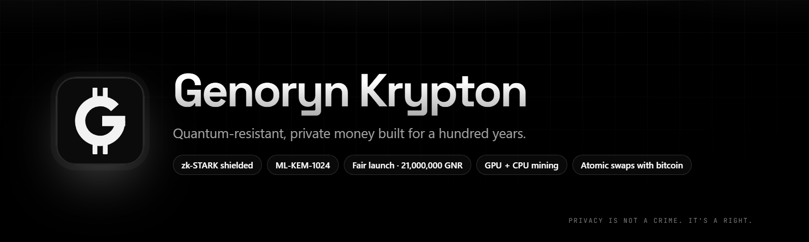
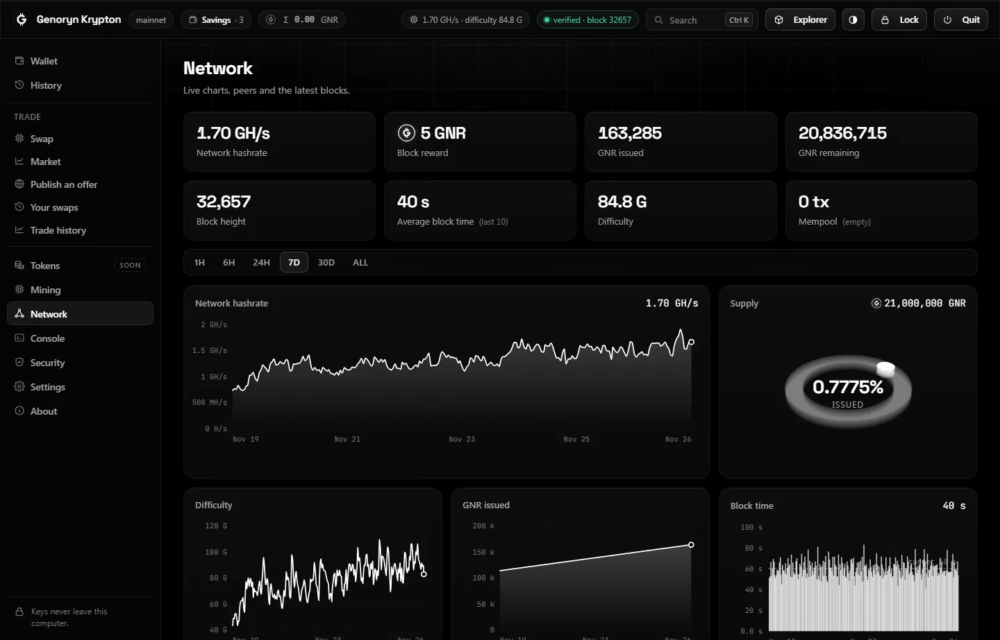
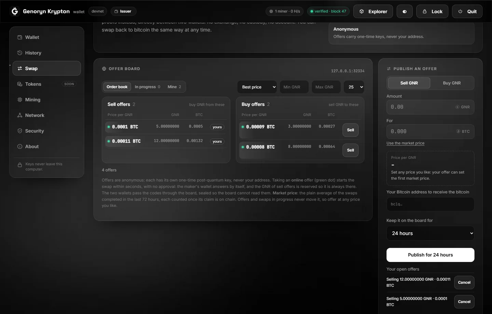
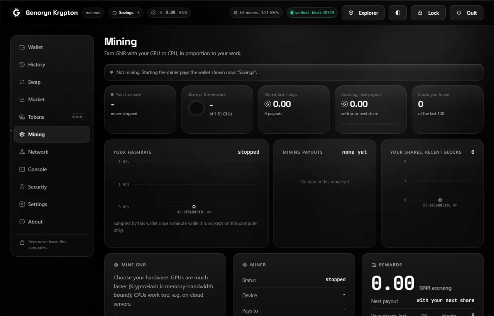
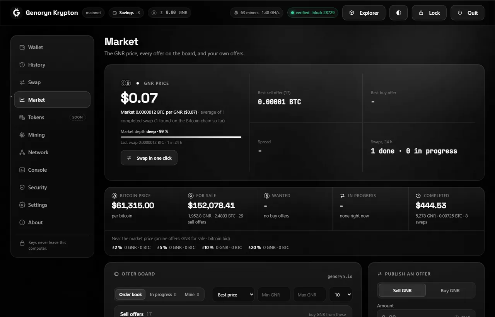
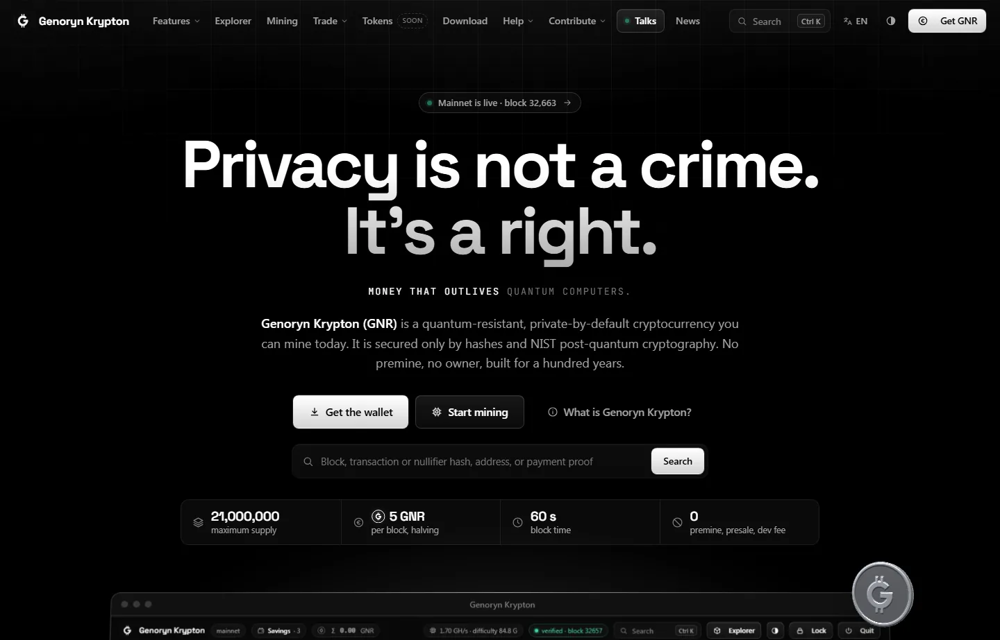
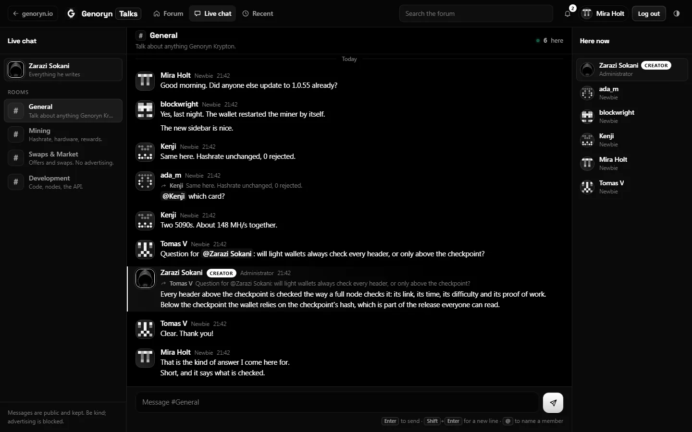

<p align="center">
  <picture>
    <source media="(prefers-color-scheme: light)" srcset="docs/images/banner-light.png">
    
  </picture>
</p>

<p align="center">
  <a href="https://github.com/genoryn/genoryn/releases/latest"></a>
  <a href="https://genoryn.io/explorer"></a>
  <a href="https://genoryn.io/talks"></a>
  
  
  
</p>

<p align="center">
  <a href="https://github.com/genoryn/genoryn/releases/latest"><b>Download for Windows</b></a> ·
  <a href="https://github.com/genoryn/genoryn/releases/latest"><b>Linux (.deb / .tar.gz)</b></a> ·
  <a href="https://genoryn.io">genoryn.io</a> ·
  <a href="https://genoryn.io/talks"><b>Genoryn Talks</b> (forum and live chat)</a> ·
  <a href="https://genoryn.io/explorer">Explorer</a> ·
  <a href="https://genoryn.io/docs">Docs</a> ·
  <a href="https://genoryn.io/faq">FAQ</a> ·
  <a href="SECURITY.md">Security</a>
</p>

<h1 align="center">Genoryn Krypton (GNR)</h1>

<h3 align="center">Money that outlives quantum computers.</h3>

<p align="center">
  <b>Genoryn Krypton (GNR)</b> is a quantum-resistant, private-by-default proof-of-work cryptocurrency<br>
  with <b>Bitcoin's monetary design</b>: 21,000,000 coins, halvings, mining, no premine.
</p>

<table>
  <tr>
    <td width="33%" valign="top"><h4>Quantum-resistant</h4>Funds are guarded by hash-based <b>zk-STARK</b> proofs, not elliptic curves. Payment data is encrypted with hybrid <b>X25519 + ML-KEM-1024</b> (FIPS 203).</td>
    <td width="33%" valign="top"><h4>Private by default</h4>Every transfer is <b>shielded</b>: amounts, senders, recipients and memos are hidden for everyone. There is no transparent mode.</td>
    <td width="33%" valign="top"><h4>Bitcoin's money</h4>At most <b>21,000,000 GNR</b>, 5 GNR per block halving every 2,100,000 blocks, 60-second blocks, a fair launch bound to a Bitcoin block.</td>
  </tr>
  <tr>
    <td valign="top"><h4>Fair mining, no pool</h4><b>KryptoHash</b> runs on GPUs and CPUs. Every block's reward is shared by all miners in proportion to their work.</td>
    <td valign="top"><h4>Swap with bitcoin</h4><b>Atomic BTC ⇄ GNR swaps</b> in the wallet move value into a quantum-resistant system: no exchange, no custody, no account.</td>
    <td valign="top"><h4>Verify, don't trust</h4>Light wallets check the chain themselves with proofs of work and Merkle Mountain Range proofs. A full node is optional.</td>
  </tr>
</table>

<p align="center">
  <sub>1 GNR = 100,000,000 <b>krypton</b>, its smallest unit · Open source (MIT or Apache-2.0) · <a href="https://genoryn.io/about">What is Genoryn Krypton?</a> · <a href="https://genoryn.io/quantum">Quantum-resistant cryptocurrency, explained</a></sub>
</p>

<table>
  <tr>
    <td width="50%"></td>
    <td width="50%"></td>
  </tr>
  <tr>
    <td align="center"><sub>Live network and mining overview</sub></td>
    <td align="center"><sub>Atomic BTC ⇄ GNR swaps: Quick Swap in one click</sub></td>
  </tr>
  <tr>
    <td width="50%"></td>
    <td width="50%"></td>
  </tr>
  <tr>
    <td align="center"><sub>Proportional GPU / CPU mining</sub></td>
    <td align="center"><sub>Market: the price and the order book</sub></td>
  </tr>
  <tr>
    <td width="50%"><a href="https://genoryn.io"></a></td>
    <td width="50%"><a href="https://genoryn.io/talks"></a></td>
  </tr>
  <tr>
    <td align="center"><sub><a href="https://genoryn.io">genoryn.io</a>: the network, live</sub></td>
    <td align="center"><sub><a href="https://genoryn.io/talks">Genoryn Talks</a>: the forum and live chat</sub></td>
  </tr>
</table>

<p align="center"><sub>The wallet, the website and Genoryn Talks share one design: black, white and grey, solid surfaces divided by hairlines. The screenshots are from a wallet made for them (empty, never mining) and from test accounts.</sub></p>

## Start mining in three steps

1. **Download** the wallet for [Windows or Linux](https://github.com/genoryn/genoryn/releases/latest) and create a wallet (write down its 24 words).
2. Open the **Mining** tab and choose your GPU (NVIDIA with CUDA, AMD or Intel with OpenCL) or your CPU.
3. Press **Start mining**. There is no pool, no account and no configuration file: every block pays all miners by their share of the work, and rewards arrive every 360 blocks (about six hours).

Live numbers: [network and hashrate](https://genoryn.io/explorer) · [mining guide and calculator](https://genoryn.io/mining) · [market and price history](https://genoryn.io/market).

---
## Why this exists

Most cryptocurrencies rest on elliptic-curve cryptography. A large enough quantum
computer running Shor's algorithm breaks it: it can forge spending signatures, and it
can decrypt every private transaction ever recorded ("harvest now, decrypt later").
Money meant to hold value for generations cannot depend on that assumption.

Genoryn Krypton is built from first principles so that **no elliptic curve protects your
coins or your privacy**, and so that everything a user needs works without trusting
anyone: private payments, fair mining without pools, wallets that verify the chain
themselves, and trading with bitcoin without an exchange.

> **Honest status.** The code is complete and tested end to end, and it has had an internal
> audit and a privately reported external review whose findings are fixed. It has **not**
> had a full independent audit yet. The STARK spend circuit, its zero-knowledge masking and
> the consensus code are original work and should be reviewed before significant value is
> trusted to them. Reviews are welcome (see [SECURITY.md](SECURITY.md)).

## At a glance

| | |
|---|---|
| Ticker and unit | **GNR**; its smallest unit is the **krypton**: 1 GNR = 100,000,000 krypton (as a satoshi is to a bitcoin) |
| Block time | 60 seconds, LWMA difficulty retarget every block (90-block window) |
| Block reward | **5 GNR**, halving every **2,100,000 blocks** (~4 years) |
| Maximum supply | **21,000,000 GNR**, enforced by every node |
| Premine / dev fee / early bonus | **None.** The genesis block issues nothing |
| Privacy | Every transfer is shielded; no transparent mode |
| Transaction | 2 inputs → 2 outputs, ~97 KB, proof ~92 KB, verified in ~2 ms |
| Proving time | ~0.5 s on a desktop CPU |
| Proof of work | KryptoHash v1, memory-bandwidth bound, GPU-first, CPU-capable |
| Mining rewards | **Proportional to hashrate**: ~32 shares per block, each paid an equal slice of the reward pool, no pool needed |
| Payouts | One note per miner every 360 blocks (~6 h), spendable after 100 blocks |
| Trading | **Atomic BTC ⇄ GNR swaps** on an anonymous offer board; the seller's GNR is locked first |
| Market price | From completed swaps, weighed by the bitcoin found on the Bitcoin chain (volume-weighted median); offers never move it |
| Quantum tokens | **Planned, not live yet:** stablecoins and other tokens anyone will be able to deploy, as private and quantum-safe as GNR |
| Payment proofs | Prove a payment to anyone without revealing anything else |
| Recovery phrase | 24 words with numbers (`orbit-42 …`), 384-bit entropy, checksummed |
| Addresses | Full post-quantum address with a 128-bit checksum, plus a verified short form |
| Light clients | FlyClient-style tip proofs, follow the most work, release checkpoint (block 14,800) |
| Updates | Signed with ML-DSA-87 + SLH-DSA, verified by the wallet before installing |

## Contents

1. [Download and install](#download-and-install)
2. [Quick start](#quick-start)
3. [The desktop wallet, tab by tab](#the-desktop-wallet-tab-by-tab)
4. [Recovery phrase, backup and addresses](#recovery-phrase-backup-and-addresses)
5. [Wallet security](#wallet-security)
6. [Updates](#updates)
7. [Privacy model](#privacy-model)
8. [Cryptography and quantum security](#cryptography-and-quantum-security)
9. [Emission, supply and scarcity](#emission-supply-and-scarcity)
10. [Fair launch](#fair-launch)
11. [Mining](#mining)
12. [Mining and price calculator](#mining-and-price-calculator)
13. [Atomic swaps with bitcoin](#atomic-swaps-with-bitcoin)
14. [The offer board](#the-offer-board)
15. [Market price](#market-price)
16. [Quantum tokens (planned)](#quantum-tokens-planned)
17. [Payment proofs](#payment-proofs)
18. [Light clients: no full node required](#light-clients-no-full-node-required)
19. [Peer-to-peer network and node security](#peer-to-peer-network-and-node-security)
20. [Running a node](#running-a-node)
21. [Command-line wallet](#command-line-wallet)
22. [API, SDKs and integration](#api-sdks-and-integration)
23. [Repository layout and specifications](#repository-layout-and-specifications)
24. [Designed for a hundred years](#designed-for-a-hundred-years)
25. [Security and audits](#security-and-audits)
26. [Troubleshooting](#troubleshooting)
27. [FAQ](#faq)
28. [Community: Genoryn Talks](#community-genoryn-talks)
29. [Author and governance](#author-and-governance)
30. [License](#license)

The same material, with more detail, is on [genoryn.io/docs](https://genoryn.io/docs).

## Download and install

| Platform | File | Notes |
|---|---|---|
| **Windows 10 / 11 (x64)** | `GenorynKrypton-<version>-Windows-x64-Setup.exe` | Installs for the current user, no administrator rights, into `%LOCALAPPDATA%\Programs\Genoryn Krypton`. Wallets and chain data live in `%APPDATA%\GenorynKrypton` and are kept when the program is removed. |
| Windows, portable | `genoryn-krypton-<version>-windows-x64-portable.zip` | The same programs without an installer |
| **Ubuntu / Debian (x64)** | `genoryn-krypton_<version>_amd64.deb` | `sudo apt install ./genoryn-krypton_<version>_amd64.deb`; desktop entry and systemd units included |
| Linux, any distribution | `genoryn-krypton-<version>-linux-x64.tar.gz` | Unpack and run `krypton-wallet` |
| From source | this repository | Rust 1.89+: `cargo build --release`; binaries in `target/release` |

All downloads: [releases/latest](https://github.com/genoryn/genoryn/releases/latest). Every
package contains four programs:

| Program | What it is |
|---|---|
| `krypton-wallet` | Desktop wallet in its own window (WebView2 on Windows, the browser elsewhere) |
| `kryptond` | Full node: validates the chain, relays blocks and transactions, serves the API |
| `krypton-miner` | GPU (CUDA, OpenCL) and CPU miner |
| `krypton-wallet-cli` | Command-line wallet |

### Verify your download

Each release publishes `SHA256SUMS` and `SHA256SUMS.sig`, a hybrid post-quantum signature
(ML-DSA-87 **and** SLH-DSA-SHAKE-256s, both must verify) by the release key, fingerprint
`e4567fb116258bdd` ([docs/release-key.pub](docs/release-key.pub)):

```sh
sha256sum -c SHA256SUMS --ignore-missing
cargo run --release -p krypton-release -- verify docs/release-key.pub SHA256SUMS SHA256SUMS.sig
```

The wallet's updater performs exactly this check before it installs anything.

## Quick start

1. **Install** the wallet (above) and open it.
2. **Create a wallet**: choose a strong password and write the 24 words with their numbers on
   paper. Nobody, the project included, can restore a wallet without them.
3. **Get GNR**: mine in the **Mining** tab, buy with bitcoin in the **Swap** tab, or share your
   short address (`gnrs1…`) to receive.
4. **Send privately**: address, amount, optional memo; the proof is built on your computer in
   about half a second.

```sh
# Build from source (Rust 1.89+)
cargo build --release

# Desktop wallet
./target/release/krypton-wallet

# Command-line wallet
./target/release/krypton-wallet-cli new
./target/release/krypton-wallet-cli --node https://genoryn.io balance
./target/release/krypton-wallet-cli --node https://genoryn.io send <address|short address> 1.5 --memo "thanks"

# Full node (mainnet): P2P 30333, API http://127.0.0.1:30334
./target/release/kryptond

# Miner (best GPU, else CPU)
./target/release/krypton-miner --node http://127.0.0.1:30334 --address-file my-address.txt --backend auto
```

## The desktop wallet, tab by tab

The wallet is a small local server bound to `127.0.0.1` with a random session token, shown
in its own window. Keys, scanning and proving never leave your computer.

| Tab | What it does |
|---|---|
| **Wallet** | Balance (spendable, incoming, maturing rewards, optional market value) with the **Bitcoin balance** for swaps beside it, **Receive** (QR code, short form, full address, *Publish short form*), **Send privately** (full or short address, amount, memo, market fee), several wallets with one total, and an overview of the network with live charts and the latest blocks |
| **History** | Paged (15 to 100 per page), filters for received, sent, mining and pending, search by memo, txid, address or block, totals, a **Proof** button for every send, and **View ↗** / **Block ↗** to open a payment's transaction or block on the genoryn.io explorer |
| **Trade** | One group with the GNR and Bitcoin balances on top of every page: **Swap** (Quick Swap: buy or sell any amount in one click), **Market** (the price, the offer board: sell, buy, in progress, yours), **Publish an offer** (1 hour to 1 year), **Your swaps** with their progress, and **Trade history** (every completed swap, in figures and charts: verified swaps first, the ones whose bitcoin the board found on the Bitcoin chain, with every other report one switch away). Offers can be paid from and paid into the wallet's own Bitcoin balance, so buying and selling needs no transfer each time |
| **Tokens** | Quantum tokens: planned for a future release (the tab explains them and turns on by itself once the network activates them) |
| **Mining** | Automatic, NVIDIA (CUDA), AMD / Intel (OpenCL) or CPU with a CPU cap; hashrate, share of the network, expected GNR per day, shares, accruing rewards, payouts, the miner's error if it stops, and the mining and price calculator |
| **Network** | Charts of hashrate, supply, difficulty, issuance, block time, shares and transactions per block (1 hour to all time), block finders, peers, and the connection mode |
| **Console** | A terminal for the chain and the wallet, as in Bitcoin's wallet: completion as you type, the most used commands one click away, and the node it asks named at the top. The chain (`getblockchaininfo`, `getblock`, `gettransaction`, `getpeerinfo`, `validateaddress`, ...) and the open wallet (`getbalance`, `getaddress`, `listtransactions`). It only reads: no command can send, reveal a phrase or key, or change a setting |
| **Security** | Change a wallet's password, lock wallets, and **delete a wallet** from this computer (with its password; refused while a swap or an offer of it is open; keep a copy or erase it for good) |
| **About** | Version, update check, automatic updates, what the wallet does, Genoryn Talks (the forum and live chat), and the security audits |

**Search (Ctrl+K)** opens a panel that goes to any tab by a few letters of its name, and locks the
wallet, switches the theme or opens the explorer. It only moves around: it never sends, swaps or
signs, and it stays shut while the wallet is locked.

**Connection mode** (Settings tab):

* **Light** (recommended): remote nodes provide data; headers, outputs and tree updates are
  verified on your computer. Several nodes can be configured and are cross-checked.
* **Full node**: one click starts `kryptond`, which downloads and validates the whole chain;
  the wallet then uses only your own node. It connects only out to other nodes unless you
  enable **Let other nodes connect to my full node**.
* **Proxy (Tor)**, optional: the wallet's own connections (the nodes it reads, the offer board,
  the Bitcoin service, the BTC price and updates) go through a SOCKS5 proxy, so those servers
  see the proxy's address instead of yours. Use `socks5h://127.0.0.1:9050` for Tor or
  `socks5h://127.0.0.1:9150` for Tor Browser; only `socks5h` is accepted, so names are resolved
  through the proxy too. It applies from the next start of the wallet, changing it needs the
  wallet password, and a node or Bitcoin Core on this computer is still reached directly.

**Background mining:** while the miner runs, closing the window keeps the wallet, node and
miner running; **Quit** stops everything. If the miner stops, the Mining tab shows why (for
example a GPU driver error); it restarts by itself, and after three quick failures in a row
the wallet stops retrying and says so.

A transaction spends at most two notes. When a payment needs more, the wallet merges notes
automatically in parallel rounds (one block per round) and then pays.

## Recovery phrase, backup and addresses

A new wallet shows **24 words, each with a two-digit number** (`orbit-42 river-07 …`): an
English BIP-39 word and a number 00–63 per token, 17 bits each, 408 bits in total that carry
**384 bits of entropy** and a 24-bit SHA3 checksum. The checksum catches any wrong word or
number on restore. A phrase of 24 words without numbers (BIP-39, as Genoryn Mainnet 1.0
and other wallets made them) restores too, typed as it is; positions written next to the
words (`1.`, `2.` …) and commas may stay. Coins of Mainnet 1.0 are not on this chain.

* **Write it on paper** (or metal), in order, with the numbers. Never type it into a website,
  chat, email or photo: whoever has it owns the coins.
* **Restore**: Wallet → *Add a wallet* → restore, or `krypton-wallet-cli restore`.
* **The wallet file** (`%APPDATA%\GenorynKrypton\mainnet\wallet.krypton`, other wallets in
  `wallets\`) holds your history and swap records. It cannot be opened without its password,
  on any computer: the key comes from the password through Argon2id (256 MiB of memory,
  3 passes) and the file is sealed with XChaCha20-Poly1305, so a changed byte is detected.
  The only attack on a copied file is guessing the password, at a quarter of a gigabyte and
  about a second per guess. The wallet asks for a strong password and shows its strength.
* **Swaps in progress live in the wallet file.** Finish or refund them before relying on a
  restore from the phrase. A restored wallet never reuses an earlier swap's secret, keys or
  outputs (every swap gets a random number).
* **Lost the password, have the phrase?** Restore with a new password. **Lost the phrase,
  have the file and password?** Show the phrase (`krypton-wallet-cli show-phrase`) and write
  it down now.

**Addresses.** The full address (~2,600 characters) carries the post-quantum ML-KEM-1024 +
X25519 key and a 128-bit checksum, so a typo or tampering is always detected. Its short form
(`gnrs1…`) is a content hash: press *Publish short form* once (it goes to genoryn.io, your
configured nodes and your own node), share it, and every sender's wallet checks that what a
node resolves hashes back to it, so a node can never substitute another recipient.

**Several wallets.** Any number, each with its own 24 words and password. The selector switches
between them; *Show all wallets* lists them with search, filters, sorting and one total.
Removing a wallet only moves its file to a `removed` folder; its 24 words bring it back.

## Wallet security

| Protection | How |
|---|---|
| Password for anything that moves coins | Sending, publishing or taking an offer and starting or accepting a swap ask for the wallet's password every time; the session token alone cannot spend |
| Guessing | After 5 wrong passwords the wallet refuses for 5 minutes |
| Auto-lock | An unlocked wallet locks itself after 24 hours; the miner keeps running, swaps wait |
| Local only | The wallet's server listens on `127.0.0.1`, checks a random token on every request and refuses other host names (DNS rebinding) |
| Nothing reaches your computer | The wallet's full node only connects out by default; its API listens only on your computer |
| Signed updates | Installed only if the post-quantum release signature verifies |

Your computer is your responsibility: malware running as your user can read your screen and
keystrokes. Keep the system updated, the phrase offline and the password unique.

## Updates

The wallet checks GitHub for a newer release, downloads `SHA256SUMS`, verifies its hybrid
ML-DSA-87 + SLH-DSA-SHAKE-256s signature against the release key compiled into the program,
downloads the installer and checks it against the signed hash. Only then does it install. A
compromised download host, CDN or GitHub account cannot push code without the release key.
*About → Check for updates*, the offer that appears, or *Install updates automatically*.
Wallets, settings and chain data carry over; a running miner resumes by itself.

## Privacy model

Coins live as **notes**: `(owner, value, randomness)` hidden inside a commitment in a Merkle
tree of depth 40. Spending a note reveals only its **nullifier**, a hash of a secret key and
the note position, which prevents double spending without revealing which note was spent.

| Visible on chain | Hidden |
|---|---|
| Fees, transaction sizes, timing | Sender and recipient |
| Commitments and nullifiers | Amounts and memos |
| Mining shares and payouts per miner | How mined coins are spent later |
| Swap locks and claims (hash lock, revealed secret, refund height) | Swap amounts and the parties' addresses |

Mining income is public per miner, as coinbase rewards are on every chain; mine to a separate
wallet if you want it unlinked from your receiving address. There is no transparent mode, so
every user shares the same anonymity set. Your own transactions are first relayed to one
random peer and announced to everyone only after 20 seconds, which hides their origin. Wallets
download the whole mempool, so nodes cannot tell which pending transaction is whose. Offers on
the board carry one-time keys, never your address, and the board cannot read the messages it
passes.

**Your IP address** is not on chain, but the servers a light wallet talks to see it. Set a Tor
proxy in Settings → Connection mode to hide it from them. The full node (`kryptond`) has no
proxy setting: its peers see its address. If that matters, use the light wallet over Tor, or
run the node with `--no-listen` so nothing can connect to it.

## Cryptography and quantum security

| Purpose | Mechanism | Assumption |
|---|---|---|
| Spending authorization | zk-STARK proof of knowledge of a secret key (hash preimage) | Collision-resistant hashes |
| Transaction privacy | Shielded notes, zk-STARK proofs (Winterfell, Rescue-Prime, SHA3-256 Merkle commitments) | Hashes + FRI soundness |
| Note encryption | Hybrid **X25519 + ML-KEM-1024** (NIST FIPS 203, level 5) → XChaCha20-Poly1305 | Either primitive unbroken |
| Peer-to-peer links | Hybrid **X25519 + ML-KEM-768** → ChaCha20-Poly1305 | Either primitive unbroken |
| Offer board keys and messages | Hybrid X25519 + ML-KEM-1024 → XChaCha20-Poly1305 | Either primitive unbroken |
| Release signing | **ML-DSA-87** (FIPS 204) **and** **SLH-DSA-SHAKE-256s** (FIPS 205) | Lattices *and* hashes (both must verify) |
| Identifiers | SHA3-256 with domain separation | Hashes |
| Proof of work | KryptoHash v1 (BLAKE3-based, memory-hard) | Hashes |
| Wallet file | Argon2id (256 MiB) + XChaCha20-Poly1305 | Symmetric primitives (256-bit keys) |
| Swap hash locks | SHA-256 (the same lock on both chains) | Hashes |

* **Shor's algorithm** breaks RSA and elliptic curves. None of them protect GNR: spends are
  proofs of knowledge of a hash preimage, verified with hash-based STARKs. Encryption is
  hybrid, so recorded traffic stays secret as long as *either* X25519 or ML-KEM holds.
* **Grover's algorithm** only square-roots brute force: 256-bit hashes and keys keep a 128-bit
  margin, the 384-bit recovery phrase keeps 192 bits, and STARK soundness targets about 160
  conjectured bits.
* **The bitcoin side of a swap** uses Bitcoin's own keys, as every Bitcoin transaction does,
  and only for the few hours a swap runs.
* **Crypto-agility:** every algorithm carries a versioned identifier, so the network can
  migrate to new primitives by soft fork if one ever weakens.

Keys derive from the recovery phrase with SHAKE256: a spend secret (giving an authorization
key `ak`, a nullifier key `nk` and the owner tag `H(ak, nk)`), a hybrid KEM key pair, an ML-DSA
key and a swap seed for one-time board keys and per-swap secrets.

## Emission, supply and scarcity

Block `h ≥ 1` issues `5 GNR >> floor((h − 1) / 2,100,000)` into the reward pool; the genesis
issues nothing. That is 7,200 GNR a day in the first era. Fees join the pool too.

| Era | Blocks | Reward | Per day | Issued in era | Cumulative |
|---|---|---|---|---|---|
| 1 (~years 0–4) | 1 – 2,100,000 | 5 GNR | 7,200 | 10,500,000 | 50.0 % |
| 2 (~4–8) | 2,100,001 – 4,200,000 | 2.5 GNR | 3,600 | 5,250,000 | 75.0 % |
| 3 (~8–12) | 4,200,001 – 6,300,000 | 1.25 GNR | 1,800 | 2,625,000 | 87.5 % |
| 4 (~12–16) | 6,300,001 – 8,400,000 | 0.625 GNR | 900 | 1,312,500 | 93.75 % |
| 5 (~16–20) | 8,400,001 – 10,500,000 | 0.3125 GNR | 450 | 656,250 | 96.88 % |

After 29 halvings the reward reaches zero; integer halving leaves total issuance less than one
GNR below 21,000,000. Every node rejects a block that would exceed the cap.

**Scarcity over time.** Stock-to-flow (coins in existence ÷ coins mined in the next year)
follows from the schedule alone; gold is about 60:

| Year | GNR in existence | New GNR that year | Stock-to-flow |
|---|---|---|---|
| 2030 | 10.5 million | 1.31 million | 8 |
| 2034 | 15.8 million | 657,000 | 24 |
| 2038 | 18.4 million | 329,000 | 56 |
| 2042 | 19.7 million | 164,000 | 120 |
| 2046 | 20.3 million | 82,000 | 248 |

GNR reaches gold's scarcity around 2041 and that of Bitcoin in 2026 around 2045. Scarcity is a
property of the schedule; it does not set a price by itself.

## Fair launch

There is no premine, no allocation and no privileged key. Rewards go only to miners, under the
same rule from block 1, and in proportion to their work.

**Mainnet is live.** Its genesis commits to the hash of **Bitcoin block 974,438**
(`00000000000000000001075275c9ea6c90ce99dd94214d855d2b726fb173bed9`), the newest Bitcoin
block at launch. That hash could not be known in advance, so no Genoryn Krypton block can
predate it, not even for its author.

| | |
|---|---|
| Genesis hash | `3c10136cd72a74d673257249752522e0102b6268f5b8c348ba34ae36740ca3b3` |
| Genesis time | 2026-11-03 20:43:11 UTC |
| Chain id | `genoryn-krypton-mainnet-1` |
| Network magic / ports | `GKM1` · P2P 30333 · API 30334 |

See [docs/launch.md](docs/launch.md) to verify it yourself. Genoryn Krypton is a new chain:
balances of the earlier Genoryn Mainnet 1.0, which used different cryptography, are not
migrated ([policy](https://github.com/genoryn/genoryn/issues/1)).

## Mining

KryptoHash reads 64 random 128-byte pairs from a large dataset per hash (2 GiB at launch,
growing 4 MiB per ~11-day epoch up to 12 GiB), so speed follows memory bandwidth: a desktop
GPU has hundreds of GB/s, a CPU tens. Verifying a block needs only a 16 MiB cache, about 1 ms,
so even light clients check proofs of work. Details: [docs/spec/kryptohash.md](docs/spec/kryptohash.md).

| Device | Hashrate (measured) |
|---|---|
| NVIDIA RTX 5090 (CUDA) | **74–83 MH/s** |
| NVIDIA RTX 4070 SUPER (CUDA, community report) | **~18.5 MH/s** |
| Intel Core Ultra 9 285K, 24 threads | **1.37 MH/s** |
| 16-thread desktop CPU (community report) | ~1.35 MH/s |
| AMD integrated GPU gfx1036 (OpenCL) | ~0.84 MH/s |

```sh
krypton-miner --list-devices          # tests every GPU: "usable" or "NOT usable: <reason>"
krypton-miner --node http://127.0.0.1:30334 --address-file my-address.txt --backend auto   # best GPU, else CPU
krypton-miner --node https://genoryn.io --address-file my-address.txt --backend cuda --devices 0,1
krypton-miner --node http://127.0.0.1:30334 --address-file my-address.txt --backend cpu --max-cpu 50
```

| Flag | Meaning |
|---|---|
| `--backend` | `auto` (best GPU, else CPU), `cuda`, `opencl` or `cpu` |
| `--node` | Node API to get work from (default `http://127.0.0.1:30334`) |
| `--address` / `--address-file` | Where rewards go: the full `gnr1...` address, or the short `gnrs1...` one (resolved by the node and checked against its hash) |
| `--max-cpu` / `--threads` | CPU threads as a percentage of the cores, or an exact count |
| `--devices` | GPU indices as in `--list-devices`, e.g. `0,2` |
| `--batch` | Nonces per GPU launch (auto-tuned by default) |
| `--json` | Machine-readable status lines; with `--list-devices`, a JSON list with `usable` and `error` |

The desktop wallet's **Mining** tab offers the same choices and a CPU limit. GPU solutions are
always re-verified on the CPU before they are submitted. If a GPU driver cannot compile the
mining kernel, the miner says so and suggests a clean driver reinstall.

### Paid by your share of the work

There are no pools and no lottery for whole blocks. Every hash is also checked against a
**share target** 32 times easier than the block target, so the network finds about 32 shares
per block. Each block adds its reward and fees to a consensus-held pool, and every share earns
its miner an equal slice: `pool · weight / (8 · 32 · difficulty)`.

| Your share of the network hashrate | Shares per hour | Expected GNR per day |
|---|---|---|
| 88 % | ≈ 1,690 | ≈ 6,336 |
| 10 % | ≈ 192 | ≈ 720 |
| 1 % | ≈ 19 | ≈ 72 |
| 0.1 % | ≈ 2 | ≈ 7.2 |

A share's credit never depends on which other shares a block includes, so censoring other
miners gains nothing, and an excluded share is credited by a later block (any of the next 32).
Earnings are paid as one note every 360 blocks, at most 64 payouts per block, spendable after
100 blocks; payout notes are built by consensus from public data and verified by light wallets.
Keep the miner online: shares count once they reach the network. Rules:
[docs/spec/rewards.md](docs/spec/rewards.md).

**No external pools. No pool fees. Every miner is rewarded directly by the blockchain in
proportion to their valid shares.** Guides: [for miners](docs/mining/for-miners.md) ·
[how rewards are calculated](docs/mining/reward-calculation.md) ·
[compared with pools](docs/mining/vs-pools.md) · [fairness and security](docs/mining/security-fairness.md) ·
[mining FAQ](docs/mining/faq.md) · [for developers](docs/mining/native-rewards.md).

### Hive OS

A custom miner package for Hive OS ships with each release (`genoryn-<version>.tar.gz`): add
it as a Custom miner in a Flight Sheet with your `gnrs1...` address as the wallet and
`https://genoryn.io` (or your farm's own node) as the pool URL. The package checks the miner's
SHA-256 before every start and reports hashrate and shares to the Hive dashboard.
Guide: [docs/hiveos](docs/hiveos/README.md).

## Mining and price calculator

The wallet's Mining tab and [genoryn.io/mining](https://genoryn.io/mining#calc) carry the same
calculator, fed by live chain data:

* **Join now:** from the network's live hashrate, what 1, 10, 100, 1,000 or more GPUs would
  mine: share, GNR per day, month and year, time per GNR, value at the market price.
* **The future:** choose a year (up to 40 ahead) and how many computers mine; the reward follows
  the halvings by block height.
* **Scarcity:** stock-to-flow by year, next to Bitcoin's and gold's.
* **Price models, all "what if", none a forecast:**
  1. *The work behind one GNR:* today's price × how many times more work one GNR takes then
     (more computers sharing the reward, halvings passed).
  2. *A share of Bitcoin's value:* that share divided by the GNR that exist in the chosen year.
  3. *People and dollars:* people × the dollars each holds ÷ the GNR that exist then.

Electricity and hardware are not counted. The real price is only what people pay each other.

## Atomic swaps with bitcoin

GNR is not traded on any exchange, and there was no presale. It is earned by mining, or bought
from another person with bitcoin in the wallet's **Swap** tab, with no exchange and no custody.

**Why swaps with bitcoin.** Bitcoin's coins are guarded by elliptic-curve signatures, which a
large enough quantum computer could break. An atomic swap lets a bitcoin holder move value into
GNR, which is guarded by hash-based proofs instead, straight from their own wallet, and swap
back the same way at any time. (A swap exchanges bitcoin for GNR at the market price; the
bitcoin itself stays on Bitcoin's chain with its new owner.)

Both sides lock their coins under the same **hash lock** (SHA-256 of a secret) with a
**timelock**: whoever reveals the secret to take one side also lets the other side take theirs,
and if nobody does, both refund. Since 1.0.23 **the GNR is locked first**:

1. **Agree.** A buyer takes a sell offer, or a seller takes a buy offer. The wallets exchange
   the swap codes as sealed messages that the board relays from wallet to wallet, by themselves,
   within seconds. No e-mail is involved: the board is part of every node.
2. **The seller locks the GNR.** The seller's wallet holds the secret and locks exactly the
   agreed GNR on chain, payable only to the buyer with that secret, or back to the seller after
   the GNR timelock.
3. **The buyer checks and pays.** The buyer's wallet waits until the lock has confirmed and is
   exactly the agreed amount, claimable only by the buyer. Only then does it show where to pay
   (amount, address, QR code). The buyer pays within 2 hours into a bitcoin contract with the
   same hash lock.
4. **The seller takes the bitcoin** with the secret, well before the bitcoin timelock. That claim
   reveals the secret on the Bitcoin chain.
5. **The buyer takes the GNR** with the secret read from the seller's bitcoin claim.

Nobody can sell GNR they do not have: a sell offer is listed only after the board has checked
a proof that its GNR is there (see [the offer board](#the-offer-board)), and a seller cannot
lock what it does not have. The seller cannot take the bitcoin without releasing the GNR to
the buyer.

| Mainnet timing | Value |
|---|---|
| GNR confirmations the buyer waits for | 3 blocks for a payment up to 0.001 BTC, 6 up to 0.01 BTC, 15 up to 0.1 BTC, 30 above |
| Bitcoin confirmations the seller waits for | 1 up to 0.01 BTC, 2 above |
| Payment window | 2 hours after the GNR lock has confirmed |
| GNR timelock | 1,260 blocks (about 21 hours); 1,900 (about 32 hours) when the buyer's wallet is older than 1.0.43 |
| Bitcoin timelock | 18 Bitcoin blocks (about 3 hours) |
| Longest possible swap | One week; longer terms are refused |

**If something stops:** a buyer who never pays ends the swap and the seller's GNR returns after
its timelock; a seller who never claims lets the buyer's bitcoin return after its timelock; a
side that cancels before anything of its own is locked tells the other side, whose swap ends
too. Keep the wallet running (the window may be closed) and unlocked until your swaps are done:
only your wallet holds the keys that lock, claim and refund your coins, which is also why
nobody else can take them. Specification: [docs/spec/atomic-swaps.md](docs/spec/atomic-swaps.md).

## The offer board

The board, run by nodes under `/v1/swap`, lists offers and passes sealed messages between the
two wallets of a swap; it never sees keys, codes or coins.

| | |
|---|---|
| Durations | 1 hour, 6 hours, 24 hours, 3 days, 1 week, 1 month or 1 year |
| Prices | **Any price may be offered**; the wallet only warns about a likely typo (3× from the market) |
| Amounts | 10,000 sat to 1,000 BTC per offer |
| Proof of work | 18 bits per offer, message and report; offers longer than a day need one bit more per doubling (21 for a week, 23 for a month, 27 for a year: seconds on a modern CPU) |
| Proof of funds | A sell offer is listed only after its GNR is set aside in a note of its own and the board has checked a zero-knowledge proof that the seller can spend it. The proof fits that offer only and can never be mined: nothing moves. The board takes the offer down the moment the note is spent, and no note backs two offers, or an offer and a swap in progress |
| While it is open | The note cannot be sent or put into another offer; a take locks exactly it |
| Buyers whose bitcoin is ready | A sell offer is by default only for buyers whose bitcoin is already at an address of their own wallet: the seller's wallet checks that on the Bitcoin chain before it locks GNR, and the buyer's wallet pays by itself. For other buyers a wallet holds at most two unpaid locks at a time |
| One wallet, several computers | Each copy reports its swaps, encrypted, as sealed messages on the board that only copies of that wallet can read; another computer shows them and can carry one on if the first is gone |
| A week's commitment | Publishing a sell offer commits its GNR for 7 days: it can be sold or go into another sell offer at once, but not be sent, also after cancelling or after the offer ran its time. A rule of the wallet; the chain cannot tell a real sale from a seller selling to themselves |
| Buy offers | The bitcoin is paid in advance to an address of the buyer's own wallet (a contract cannot hold it before a seller exists: it names the seller's key and the hash of the seller's secret). The board checks on the Bitcoin chain that it is there and marks the offer. When a seller's GNR is locked and confirmed, the buyer's wallet pays the contract by itself; if nobody sells, it sends the bitcoin back |
| One wallet, two computers | Offers and swaps live in the wallet that started them. A second copy of the wallet shows the GNR as locked in a swap elsewhere and takes it back 30 blocks after its lock ends if the first copy is gone |
| Online | The maker's wallet pings every 45 s; seen in the last 2 minutes = green dot, takeable, swap starts within seconds without approval |
| Offline | Stays listed, greyed out, not takeable; removed after a week offline (the wallet then frees the GNR) |
| In progress | Only the maker can mark a taken offer "in progress"; it is shown as taken, not paid yet, until the bitcoin is in its contract, and only paid swaps count as running. The maker's wallet confirms every 10 minutes and removes the entry as soon as the swap can no longer complete |
| Limits | Up to 5,000 offers, up to 100 sealed messages per wallet kept a day, per-client rate limits |
| Anonymity | Each offer has its own one-time X25519 + ML-KEM-1024 key, never your address |

### Quick Swap

Quick Swap (wallet 1.0.46) buys or sells any amount of GNR in one step, at the top of the Swap
tab. You say how much, in dollars, bitcoin or GNR; the wallet finds the best prices on the board
and swaps exactly that amount.

| | |
|---|---|
| Parts | Up to 3 offers at once, best price first, each part its own atomic swap with its own contract. The seller's GNR is locked on chain before any bitcoin moves, as in every swap |
| Which offers | Quick Swap offers whose makers are online, with their GNR proven (sell) or their bitcoin found deposited (buy) |
| Price | A part costs its offer's price, rounded in the maker's favour to the sat. A part that does not start (taken by someone else a moment earlier, maker gone silent for 2 minutes) is replaced, never at more than 1 % above the worst price you were shown (or below it, when selling) |
| Bitcoin balance | An address of the wallet's own, from the 24 words. Buying pays from it at once, once it has one confirmation; selling is paid into it; it can be sent out at any time, except what running Quick Swaps still need |
| Quick Swap offers | Tick Quick Swap when you publish. Anyone can then swap any part of the offer, from its smallest part (at least 10,000 sat) up to all of it. It is listed as up to 3 lots so several people can swap at once; after a part, the rest goes back on the board by itself (sell: after the next block, from the change of the lock; buy: once the change of the payment has one confirmation). A buy offer is paid from the Bitcoin balance |
| Promises | Before a seller's wallet locks GNR for a buyer whose bitcoin waits at a deposit, it shows the board the buyer's signed word. The board adds up what that deposit is promised to across all sellers; a seller locks only if the deposit covers it all. Only an offer's maker (or a buy offer's own deposit) can make a promise, so the board cannot be flooded with them |
| Time | About 10 to 20 minutes for a small part, mostly the bitcoin confirmation |
| Older versions | See Quick Swap offers as ordinary offers and can take them whole. No change to the rules of the chain |

## Market price

The GNR price shown by the wallet and genoryn.io is the board's market price and nothing else:
**where half of the bitcoin in completed swaps changed hands below, and half above**.

* After a swap completes, the wallets report its amounts and hash lock (on by default; the
  `share_prices` setting turns it off). The board accepts a report only if a claim with that hash
  lock is on its own chain, and counts each hash once.
* **From 1.0.44 a report proves its bitcoin.** It names the swap's bitcoin contract and is
  signed with one of the contract's two keys, which only the swap's two wallets hold. The board
  looks the contract up on the Bitcoin chain and notes how much was taken out of it with the
  swap's secret. A swap whose two wallets report different amounts does not count.
* With three or more such swaps of at least 0.001 BTC, the price is their **weighted median**
  (method `gnr-price-2`, from 1.0.53). It uses the shortest window that has enough of them:
  the last 24 hours when the market is busy (8 swaps over at least three 6-hour blocks),
  otherwise 72 hours, 7 days or 30 days. Newer swaps weigh more (one at the window's end half
  as much as a new one). A swap weighs the bitcoin it moved, never more than its GNR is worth
  at the going price, never more than a fifth of the total, and the swaps of one 6-hour block
  never more than a quarter. Reports without a proof then weigh nothing. One or two large
  swaps, or a burst in one afternoon, cannot set the price.
* Swaps far from the rest are left out: more than 4× from the median, then any further from it
  than five times the typical deviation (a swap within 50 % of the median is always kept).
* The price moves at most 10 % an hour. It is rebuilt hour by hour from the swaps themselves,
  so anyone with the same swaps gets the same price.
* Every price comes with a **confidence** from 0 to 100: how much bitcoin is behind it (half
  the score at 0.01 BTC), how many swaps effectively count, how closely they agree (half at a
  15 % spread) and how fresh the newest is. Its status reads reliable, moderate, low
  liquidity, low confidence, stale (no swap for 72 hours), insufficient or unavailable.
* Until there are three, the price is still forming: the plain average of the reported swaps,
  shown as such, with confidence 0.
* Anyone can recompute it: the wallet console's `verifymarketprice` rebuilds the price from
  the board's history and compares it; the method is in
  [docs/spec/market-price.md](docs/spec/market-price.md).
* **Offers and swaps in progress never move it**; they are listed with their totals in bitcoin
  and dollars. Dollar values use the BTC price, which genoryn.io fetches from mempool.space so
  browsers and wallets contact no third party.

What this cannot do: tell a swap between two people from a swap someone makes with themselves.
It makes such a swap cost what a real one costs, real bitcoin through a real contract and the
fees of both chains, and it bounds what any one swap can do. An offer that follows the market
price therefore never goes past the limit its owner set.

[genoryn.io/market](https://genoryn.io/market) lists every offer and every completed swap with
what the GNR chain proves: the claim transaction, its block, the hash lock, the revealed secret
and the refund height.

## Quantum tokens (planned)

> **Planned for a future release. Not live:** no token exists on Genoryn Krypton today.

In a future release, anyone will be able to deploy a token on Genoryn Krypton: stablecoins
backed by an issuer's reserves, project and community tokens, tokens brought from other
networks. Quantum tokens will live in the same shielded note tree as GNR and move the same way:

* **Private.** Every transfer a zk-STARK proof: the token, the amount, the sender and the
  recipient hidden. Only the creation and destruction of tokens public, so every supply can
  be audited.
* **Quantum-safe.** Hash-based STARK spends, post-quantum encryption and post-quantum
  issuer signatures.
* **Declared up front.** No smart contracts: a token is a short public declaration of
  everything its issuer may ever do (supply, burning, pausing). It is fixed for good and shown
  to every holder in plain words. No issuer can take tokens, see balances or freeze a holder.
* **GNR at the core.** Fees in GNR, and tokens trade against GNR in one atomic transaction
  between two wallets.

| Step | Status |
|---|---|
| Design and code (circuit, consensus, wallet, trading), with tests and a public specification | Done |
| Review, then a release that names the activation block | Next |
| Deploy, send and trade tokens from the wallet's **Tokens** tab | After activation |

Older nodes reject token transactions, so activation is a consensus upgrade announced ahead
of time. Design: [docs/spec/assets.md](docs/spec/assets.md) · Overview:
[genoryn.io/tokens](https://genoryn.io/tokens).

## Payment proofs

Every transfer is private, yet you can still prove you paid. In the wallet's **History** tab,
press **Proof** next to a payment (or run `krypton-wallet-cli prove-payment <txid>`) and give the
`gnrpay1…` text to whoever needs it. They verify it in their wallet (or with `verify-payment`, or
`POST /v1/verify-payment`) and see the amount, memo, recipient, block and confirmations, checked
against the chain. The proof discloses the one-time key of that single output and nothing else:
not your balance, your other payments or your keys. It works the moment you send: until the next
block it verifies as **pending**, then as confirmed. A 128-bit checksum rejects altered proofs.

## Light clients: no full node required

A wallet should not need hundreds of gigabytes to show a balance. Light wallets **trust servers
for availability only, never for validity**:

1. **Tip:** every header commits to a work-weighted Merkle Mountain Range of all previous blocks.
   The wallet samples headers across the whole history, checks each one's proof of work and MMR
   inclusion against the tip, and fully checks the recent 91 headers, including the difficulty
   rule. Cost grows with log(chain length).
2. **Checkpoint:** every release carries a checkpoint (mainnet: block 14,800) that the chain must
   contain; headers above it need at least 1/16 of its difficulty, also on average.
3. **No future blocks:** a header dated more than two hours ahead of the computer's clock is
   refused, so a fork cannot lower its own difficulty quickly.
4. **The most work wins:** the MMR proves the chain's total work. The wallet remembers the most
   work it has verified and refuses a lighter chain, so a cheap fork cannot replace the chain it
   follows and faking confirmations costs as much as honest mining. If a node proves the wallet
   followed a fork, the wallet goes back to the fork point by itself.
5. **Your blocks:** compact blocks since the wallet birthday are checked against their headers
   (outputs, nullifiers, payouts, note-tree root).
6. **Witnesses:** to spend, the wallet downloads a whole 4,096-leaf chunk and computes its own
   Merkle path, so the server learns only the chunk.
7. **Cross-checks:** several configured nodes must agree; transactions go out through all of them.

Specification: [docs/spec/light-client.md](docs/spec/light-client.md).

## Peer-to-peer network and node security

A node is built so that other nodes can never use it against the computer it runs on.

| | |
|---|---|
| Encryption | Every link: X25519 + ML-KEM-768 handshake, ChaCha20-Poly1305 frames |
| Memory safety | Networking code in Rust with **no `unsafe` code**; peers can only send protocol messages, never commands or file access |
| Limits | Frames ≤ 8 MiB (checked before allocating), caps on every list, 10 s handshakes, ≤ 64 handshakes at once, 30 s to introduce itself, ≤ 4 connections per IP (IPv6 /64), 64 inbound and 8 outbound peers, bounded send queues |
| Bans | Malformed messages, invalid blocks or transactions, shares without work: disconnect and refuse the IP for 24 hours |
| Address book | Only public internet addresses on unprivileged ports (never this computer, its local network or special ranges), at most 16 per network group (IPv4 /16, IPv6 /32), one list per peer every 10 minutes, seeds first when a node has few peers |
| Wallet's node | **Outbound-only by default**: nothing on the internet can open a connection to your computer unless you allow it |
| API | Listens on `127.0.0.1` by default; no administrative or wallet functions |

Specification: [docs/spec/addresses-and-p2p.md](docs/spec/addresses-and-p2p.md).

## Running a node

A step-by-step guide for Linux, Windows and macOS, with why a full node matters and what it
costs, is at [genoryn.io/full-node](https://genoryn.io/full-node).

```sh
kryptond                                       # mainnet: P2P 0.0.0.0:30333, API 127.0.0.1:30334
kryptond --no-listen                           # connect out only
kryptond --listen 0.0.0.0:30333 --rpc 127.0.0.1:30334 --peer 2.24.162.163:29710
sudo bash deploy/setup-server.sh mainnet --miner address.txt   # Linux server: systemd, CPU miner capped at 50 %
sudo bash /usr/lib/genoryn-krypton/deploy/setup-server.sh mainnet   # the same after installing the .deb
```

| Flag | Default | Meaning |
|---|---|---|
| `--network` | mainnet | mainnet, testnet or devnet |
| `--data-dir` | `%APPDATA%\GenorynKrypton` or `~/.genoryn-krypton` | Chain database |
| `--listen` | `0.0.0.0:30333` | P2P listen address |
| `--no-listen` | off (on for the wallet's node) | Accept no incoming peers |
| `--rpc` | `127.0.0.1:30334` | API listen address |
| `--peer` | – | Extra peer (host:port), repeatable |
| `--no-seeds` | off | Do not use the built-in seeds |
| `--max-inbound` / `--max-outbound` | 64 / 8 | Peer limits |
| `--api-host` | – | Host names the API also answers to when a reverse proxy on the same computer passes no `X-Real-IP` (comma-separated; also `KRYPTON_API_HOSTS`). Better: let the proxy set `X-Real-IP` |

| Network | P2P | API | Reward maturity |
|---|---|---|---|
| Mainnet | 30333 | 30334 | 100 blocks |
| Testnet | 31333 | 31334 | 20 blocks |
| Devnet (local) | 32333 | 32334 | 2 blocks |

Storage grows by at most ~4 MiB per block when blocks are full; empty blocks are a few kilobytes.
Expose the API to the internet only behind a reverse proxy with limits (see `deploy/caddy`).

## Command-line wallet

`krypton-wallet-cli [--node URL[,URL…]] [--wallet FILE] [--network NAME] <command>` (or
`KRYPTON_NODE`, `KRYPTON_WALLET`, `KRYPTON_NETWORK`). With several nodes it syncs from the first,
cross-checks the others and sends through all of them.

| Command | What it does |
|---|---|
| `new` | Create a wallet and show its 24-word recovery phrase once |
| `restore [--birthday H]` | Restore from a recovery phrase (asks for the words) |
| `address [--publish]` | Show the receiving address; `--publish` makes its short form resolve on the node |
| `sync` / `balance` | Verified light sync / the balance |
| `send <address> <amount> [--memo …] [--fee …]` | Send GNR to a full or short address |
| `consolidate` | Merge the two largest notes |
| `history` / `notes` | Transactions / owned notes |
| `show-phrase` | Show the recovery phrase (asks for the password) |
| `reset-pending` | Forget unconfirmed spends after they expired |
| `status` | Status of every configured node |
| `prove-payment <txid>` / `verify-payment <proof>` | Create / check a payment proof |

## API, SDKs and integration

Every node serves the same API; the public node is `https://genoryn.io`. Amounts are in krypton,
prices in sat per GNR.

| Group | Endpoints |
|---|---|
| Chain | `GET /v1/info` · `/v1/supply` · `/v1/stats?range=…` · `/v1/blocks` · `/v1/block/{height\|hash}` · `/v1/header/{h}` · `/v1/rawblock/{h}` · `/v1/peers` |
| Transactions | `GET /v1/tx/{txid}` · `POST /v1/tx` · `GET /v1/mempool` · `/v1/fee` · `/v1/rawtx/{txid}` · `/v1/nullifier/{hex}` · `POST /v1/verify-payment` |
| Light wallets | `GET /v1/compact` · `/v1/frontier/{h}` · `/v1/subtree/{chunk}` · `/v1/witness/{pos}` · `/v1/mmrproof` · `/v1/flyclient` |
| Addresses | `GET /v1/validate/{address}` · `POST /v1/address` · `GET /v1/address/{short}` · `/v1/address-info/{address}` |
| Mining | `POST /v1/mining/template` · `POST /v1/mining/submit` · `GET /v1/miner/{address}` · `/v1/shares` |
| Swap board | `GET/POST /v1/swap/offers` · `POST /v1/swap/offers/cancel` · `/v1/swap/offers/ping` · `/v1/swap/progress` · `/v1/swap/inbox` · `GET /v1/swap/inbox/{id}` · `POST /v1/swap/trade` · `GET /v1/swap/market` · `GET /v1/swap/history` (pages of every completed swap) · `GET /v1/swap/history/summary` |
| JSON-RPC 2.0 | `POST /rpc`: `getinfo`, `getblockcount`, `getbestblockhash`, `getblockhash`, `getblock`, `getblockheader`, `gettransaction`, `sendrawtransaction`, `getmempoolinfo`, `getpeerinfo`, `getnetworkhashps`, `getsupply`, `validateaddress`, `resolveaddress`, `getblocktemplate`, `submitwork` |
| WebSocket | `wss://genoryn.io/v1/ws`: node info, then `{"type":"block",…}` and `{"type":"tx",…}` events |

```sh
curl -s https://genoryn.io/v1/info
curl -s https://genoryn.io/v1/swap/market
curl -s https://genoryn.io/rpc -d '{"jsonrpc":"2.0","id":1,"method":"getblock","params":[1]}'
```

**SDKs:** Rust (`krypton-sdk`), C (`libkrypton` + [`krypton.h`](crates/krypton-sdk/include/krypton.h)),
TypeScript ([`sdk/js`](sdk/js/krypton.ts)).

```ts
import { KryptonClient, formatAmount } from "@genoryn/krypton";
const k = new KryptonClient("https://genoryn.io");
const info = await k.info();
console.log(info.height, formatAmount(BigInt(info.supply)));
k.subscribe(e => e.type === "block" && console.log("new block", e.height));
```

```rust
use krypton::{NodeClient, Wallet, Address};
let node = NodeClient::new("https://genoryn.io")?;
let mut wallet = Wallet::open("wallet.krypton".as_ref(), &password)?;
wallet.sync(&node, |_, _| {})?;
let to = Address::decode(&recipient)?;
wallet.send_auto(&node, &to, 150_000_000, 200_000, "memo", |s| println!("{s}"))?;
```

**Exchanges and services:** run your own `kryptond`; use a dedicated wallet and tell customers
apart by memo or account; credit after 10 confirmations (more for large amounts); validate
addresses with `/v1/validate` or `krypton_address_network`; give customers payment proofs when a
withdrawal is disputed. Guides: [docs/integration](docs/integration).

## Repository layout and specifications

| Path | Contents |
|---|---|
| `crates/krypton-crypto` | Post-quantum primitives (ML-KEM, ML-DSA, SLH-DSA, hybrid KEM, Rescue-Prime) |
| `crates/krypton-zk` | The shielded spend AIR and STARK prover/verifier |
| `crates/krypton-pow` | KryptoHash: CPU, CUDA and OpenCL implementations |
| `crates/krypton-core` | Consensus types, rules, emission, difficulty, note tree, MMR, addresses |
| `crates/krypton-store` | Persistent chain state, fork choice, reorganizations |
| `crates/krypton-p2p` | Post-quantum encrypted peer transport, limits, address book |
| `crates/krypton-light` | Light-client protocol and verified HTTP client |
| `crates/krypton-wallet-core` | Wallet engine: keys, sync, shielded transfers, swap locks |
| `crates/krypton-swap` | BTC ⇄ GNR atomic swaps: the Bitcoin HTLC, the swap engine, the offer board and the market price |
| `crates/krypton-assets` | Krypton coins: the canonical manifest, coin ids, reserved names and risk labels |
| `crates/krypton-sdk` | Integration SDK and C ABI |
| `apps/kryptond` | Full node, API, offer board |
| `apps/krypton-miner` | Miner |
| `apps/krypton-wallet` | Desktop wallet (native window, local UI, updater) |
| `apps/krypton-wallet-cli` | Command-line wallet |
| `apps/krypton-setup` / `apps/krypton-release` | Windows installer / release signing and verification |
| `website` | genoryn.io (static site, explorer, market) |
| `design` | Shared design tokens and assets |
| `deploy` | Server setup, systemd units, Caddy configuration |
| `docs` | Specifications, audits, integration, launch and design |

| Specification | Topic |
|---|---|
| [consensus.md](docs/spec/consensus.md) | Blocks, headers, validity rules, difficulty, fork choice |
| [spend-circuit.md](docs/spec/spend-circuit.md) | The zk-STARK spend circuit |
| [rewards.md](docs/spec/rewards.md) | Shares, the reward pool, payouts |
| [kryptohash.md](docs/spec/kryptohash.md) | The proof-of-work algorithm |
| [light-client.md](docs/spec/light-client.md) | Header MMR, FlyClient, work rules, compact blocks |
| [addresses-and-p2p.md](docs/spec/addresses-and-p2p.md) | Addresses, short forms, the peer protocol |
| [atomic-swaps.md](docs/spec/atomic-swaps.md) | Swaps, the offer board, the market price |
| [assets.md](docs/spec/assets.md) | Krypton coins: manifests, version-3 transactions, the coin circuit, verification, coin swaps |
| [launch.md](docs/launch.md) · [design.md](docs/design.md) | The launch procedure · design rationale |

## Designed for a hundred years

* **Crypto-agility:** algorithms are versioned; new ones arrive by soft fork with version bits,
  never by surprise.
* **Bounded growth:** fixed-size headers (332 bytes), a 4 MiB block limit, bounded decoders,
  mempool and board, and per-block commitments that light clients check without history.
* **Log-time verification:** the header MMR keeps light-client cost logarithmic forever.
* **Hash-based core:** spend authorization and privacy depend only on hash functions, the most
  conservative assumption cryptography has.
* **Note tree for 2^40 outputs:** room for about a trillion payments.
* **No owner:** nothing in the protocol depends on any person or organization existing.
* **Roadmap:** recursive proof aggregation per block, prebuilt GPU kernels per architecture,
  more independent public nodes, external audits.

## Security and audits

* **26 November 2026, 1.0.53 audit** ([full report](docs/audit/2026-11-26-system-audit-1.0.53.md),
  [summary on genoryn.io](https://genoryn.io/audits)): four reviewers covered the swaps with
  bitcoin, the node and its network, the desktop wallet, and cryptography with the light client.
  No way was found to mint coins beyond the schedule, spend someone else's GNR, break transfer
  privacy or forge a block for a full node. 27 findings are fixed in 1.0.53, among them light
  wallets now checking every block above the release checkpoint as a full node does; no consensus
  rule changes.
* **26 November 2026, full audit** ([full report](docs/audit/2026-11-26-full-audit.md),
  [summary on genoryn.io](https://genoryn.io/audits)): six reviewers covered the desktop wallet,
  the atomic swaps and the offer board, Bitcoin keys and signing, the node, updater and
  installers, consensus and cryptography, and the website and forum. No way was found to mint
  coins beyond the schedule, spend someone else's GNR, break transfer privacy or forge a block.
  30 findings, most of them in the swaps with bitcoin, are fixed in 1.0.52, which changes no
  consensus rule.
* **November 2026, private report:** an independent researcher reported issues through GitHub
  security advisories (light-client chain selection, swap board authorization, and smaller
  hardening items). All were confirmed and fixed in **1.0.33**, together with a swap-secret reuse
  in restored wallets found while answering an issue, and peer address-book hygiene. Details are
  published once most wallets have updated.
* **5 November 2026, internal audit** ([full report](docs/audit/2026-11-05-security-audit.md),
  [previous review](docs/audit/2026-11-security-review.md)): four reviewers covered the node and
  peer-to-peer layer, consensus and rewards, the wallets and light client, and the website and
  server. No way was found to mint coins beyond the schedule, spend someone else's coins, break
  transfer privacy or forge a block; every fixable finding was fixed in 1.0.7.

| What was checked | Result |
|---|---|
| Emission, reward pool, share crediting, reorg undo | Correct; two reward-timing refinements scheduled for a consensus upgrade |
| zk-STARK spends, post-quantum note encryption, release signatures | No issues |
| Desktop wallet (local API, 24-hour lock, updater, multi-wallet) | Script injection from a hostile node fixed; updater and lock hardened |
| Light-client verification | Checkpoint, difficulty floor, and since 1.0.33 total-work rules: a fake chain costs real mining |
| Public node API and P2P | Per-client limits, bounded downloads, side-branch disk limit, WebSocket caps, public-only address book |
| Swaps and the board | Maker-only board actions, unique swap secrets, end-to-end swaps against Bitcoin Core before releases |
| Explorer and website | Strict CSP, no inline script, API data escaped |
| Dependencies | No known vulnerabilities (`cargo audit`) |
| Server | Key-only SSH, sandboxed services, web traffic only via Cloudflare over HTTPS, no keys stored |

Over a hundred automated tests cover consensus, proofs, reorganizations, forged light-client
data, fake chains, swap flows, board abuse and parser properties. Please report vulnerabilities
privately as described in [SECURITY.md](SECURITY.md) (coordinated disclosure, 90 days). Do not
test against other people's funds or nodes.

## Troubleshooting

<details><summary><b>My GPU is not used, or the miner says "no usable … GPU found"</b></summary>

Run `krypton-miner --list-devices`: it tests every GPU and prints `usable` or
`NOT usable: <reason>`. If the driver could not compile the mining kernel, reinstall the GPU
driver cleanly (on NVIDIA, for example after DDU) and try again. The Mining tab shows the same
reason when the miner stops.
</details>

<details><summary><b>The wallet does not sync, or a node "shows a chain with less proof of work"</b></summary>

A light wallet refuses a node that is behind or shows a lighter chain than one it already
verified. Wait a few minutes, add another node in Settings → Connection mode, or start your own
full node. "The node's chain ends before this release's checkpoint" means the node is far behind
or on another network.
</details>

<details><summary><b>My swap seems stuck</b></summary>

Keep the wallet running and unlocked; the swap card says what it waits for. If the buyer never
pays, the seller's GNR returns after about 21 hours; if the seller never claims, the buyer's
bitcoin returns after about 3 hours.
</details>

<details><summary><b>My offer shows as offline</b></summary>

Offers can be taken only while the maker's wallet runs. An offline offer stays listed and is
removed after a week offline, freeing its GNR. Open the wallet to bring it back online.
</details>

<details><summary><b>"Too many wrong passwords"</b></summary>

After five wrong passwords the wallet refuses for five minutes. If you forgot the password,
restore the wallet from its recovery phrase with a new one.
</details>

## FAQ

<details><summary><b>Do I need a GPU or a pool?</b></summary>

Neither. A GPU is about 50 times faster than a CPU, but CPUs mine too, and every block pays all
miners by their shares, so one computer earns its share every block without a pool.
</details>

<details><summary><b>Can anyone see my balance?</b></summary>

No. Balances are computed only by wallets that hold the keys.
</details>

<details><summary><b>How do I buy GNR, and can a swap cheat me?</b></summary>

Quick Swap on the Swap tab buys or sells any amount in one click; on the Market tab, take a
sell offer or publish a buy offer. You pay bitcoin only after the
seller's GNR is locked for you on chain, and the seller's claim of your bitcoin reveals the
secret that releases the GNR to you. If anyone stops, timeouts refund both.
</details>

<details><summary><b>Where does the price come from?</b></summary>

Only from completed swaps of the last 72 hours whose bitcoin the board found on the Bitcoin chain: the price at which half of that bitcoin changed hands below and half above. Offers never move it.
</details>

<details><summary><b>Can someone break into my computer through the node?</b></summary>

No. The wallet's node only connects out unless you allow incoming peers, its API listens only on
your computer, the networking code has no unsafe code, and peers can only send checked, limited
protocol messages.
</details>

<details><summary><b>Is there a premine? What about Mainnet 1.0 coins?</b></summary>

There is no premine: the genesis issues nothing and the launch was bound to a then-future Bitcoin
block hash. Krypton is a new chain; balances of the earlier Mainnet 1.0 are not migrated
([policy](https://github.com/genoryn/genoryn/issues/1)).
</details>

<details><summary><b>I lost my recovery phrase</b></summary>

If you still have the wallet file and its password, show the phrase and write it down now.
Without the phrase, the file or the password, nobody can recover the coins.
</details>

<details><summary><b>Will I be able to deploy my own token on Genoryn Krypton?</b></summary>

Yes, in a future release: quantum tokens are designed and tested but not active yet. See
[Quantum tokens](#quantum-tokens-planned).
</details>

## Community: Genoryn Talks

<p align="center">
  <a href="https://genoryn.io/talks"></a>
</p>

**[Genoryn Talks](https://genoryn.io/talks)** is the community's forum and live chat, on
genoryn.io itself:

- **Boards** for development, mining, wallets and nodes, atomic swaps and the market, quantum
  security and cryptography, ideas, and boards by language, with announcements from Zarazi Sokani.
- **Live chat** like a messenger: rooms by theme (General, Mining, Swaps & Market, Development)
  with what is new in each, messages with their authors' pictures, answers shown with what they
  answer, members named with `@`, and who is in the room right now.
- **A picture for every member**, drawn by the server from the account (monochrome, one of eight
  to pick). Nothing is uploaded.
- **Notifications**: a bell tells you when someone answers you, names you, or posts in a topic
  you started.
- **The author's channel**: everything Zarazi Sokani writes, in every room and in the forum, in
  one place at the top of the rooms; his messages carry a *Creator* badge wherever they appear.
- **Ranks and merit** as on the oldest Bitcoin forum: good posts earn merit, and merit and
  activity raise a member from Newbie to Legendary.
- **No advertising**: links to other sites, contact details, promotions and referral codes are
  blocked by themselves. Signing up takes a name and a password: no e-mail, no phone number.

Nobody on Talks will ever need your recovery phrase, your password or your wallet file. Bugs and
feature requests still belong in [GitHub issues](https://github.com/genoryn/genoryn/issues/new/choose);
vulnerabilities go [privately](SECURITY.md).

## Author and governance

<table>
  <tr>
    <td width="250" valign="top"></td>
    <td valign="top">
      <h3>Zarazi Sokani</h3>
      <p>Genoryn Krypton was created by the pseudonymous author <b>Zarazi Sokani</b>, whose identity is unknown and will never be revealed.</p>
      <p>He does not grow Genoryn through social networks. His direction is the system itself: that it works, and that it works in a way of its own. A protocol earns its place by what it does, not by who talks about it.</p>
      <p>He is found where the work is: in <a href="https://github.com/genoryn/genoryn/commits/main">this repository</a>, and on <a href="https://genoryn.io/talks">Genoryn Talks</a>, where he answers in the open.</p>
      <p><sub>The picture is an illustration, not a photograph: it shows no real person.</sub></p>
    </td>
  </tr>
</table>

Members of the community are free to develop the project in any direction they choose,
including marketing and other initiatives, following their own strategies. The protocol itself
remains **fully decentralized**: no person, company or foundation controls it, holds keys over
it, or can change its rules. Rules change only when the people who run nodes choose to run new
software. The release key signs the project's binaries; it cannot move anyone's coins or change
consensus. Contributions are judged on their merits, in public.

## Contributing and help

Contributions and reviews are welcome: see [CONTRIBUTING.md](CONTRIBUTING.md), the
[code of conduct](CODE_OF_CONDUCT.md) and [SUPPORT.md](SUPPORT.md). Report vulnerabilities
privately ([SECURITY.md](SECURITY.md)). More answers: [genoryn.io/faq](https://genoryn.io/faq), and
the community on [Genoryn Talks](https://genoryn.io/talks).

## License

Dual-licensed under [MIT](LICENSE-MIT) or [Apache-2.0](LICENSE-APACHE), at your option.
Fonts are under the SIL Open Font License (see `design/assets/fonts`).

*Not investment advice. Mining or holding GNR is not a promise of value.*
