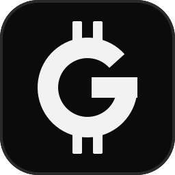
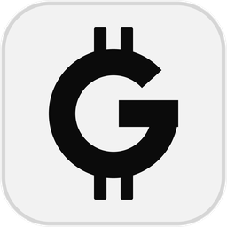

<p align="center"></p>

# GENORYN brand assets

The GENORYN sign is a bold geometric **G** crossed by two short vertical strokes, a
currency sign in the tradition of ₿. It stands for GNR, a supply that is finite by
protocol. The identity is strictly monochrome: black, white and gray.

## Files

| File | Use |
|---|---|
| `logo/genoryn-mark-dark.svg` | Primary mark: white sign on a black rounded tile. App icons, avatars, favicons. |
| `logo/genoryn-mark-light.svg` | Black sign on a light tile, for light backgrounds. |
| `logo/genoryn-sign-white.svg` | The sign alone, for dark backgrounds and beside amounts. |
| `logo/genoryn-sign-black.svg` | The sign alone, for light backgrounds and print. |
| `logo/genoryn-wordmark-white.svg` | Sign and GENORYN wordmark, for dark headers. |
| `logo/genoryn-wordmark-black.svg` | Sign and GENORYN wordmark, for light headers. |
| `logo/genoryn-banner.svg` | Repository and social banner (1280 × 320). |
| `png/genoryn-mark-dark-{16…1024}.png` | Raster exports of the primary mark. |
| `png/genoryn-mark-light-{256,512,1024}.png` | Raster exports of the light mark. |
| `png/genoryn-sign-{white,black}-{256,512,1024}.png` | Transparent raster exports of the sign. |
| `genoryn.ico` | Windows icon, 16–256 px, as embedded in `genoryn-wallet.exe`. |

<p>
  
  
</p>

## Colors

| Role | Hex |
|---|---|
| Tile black | `#0B0B0B` |
| Ink white | `#F2F2F2` |
| Secondary gray | `#9A9A9A` |
| Tile border (dark) | `#2A2A2A` |
| Tile border (light) | `#D6D6D6` |

## Usage

- Keep clear space of at least a quarter of the mark's width on every side.
- Use the tile below 24 px; the bare sign needs at least 12 px.
- Never recolor, outline, rotate, stretch or add effects to the sign.
- Place the white sign only on dark backgrounds and the black sign only on light ones.
- When the sign precedes an amount, keep the unit written after it, as the wallet
  does: the sign, then `142.57 GNR`.

## Regenerating

All files are rendered from one geometry by
[`scripts/brand/render_logo.py`](../scripts/brand/render_logo.py), which also writes
the wallet's window icon and executable icon. The wallet draws the same geometry as
vectors in `apps/genoryn-wallet/src/icons.rs`; change both together.

```sh
python scripts/brand/render_logo.py
```

The marks are released with the project under MIT OR Apache-2.0. Using them must not
suggest an official endorsement of a fork, exchange listing or token sale.
